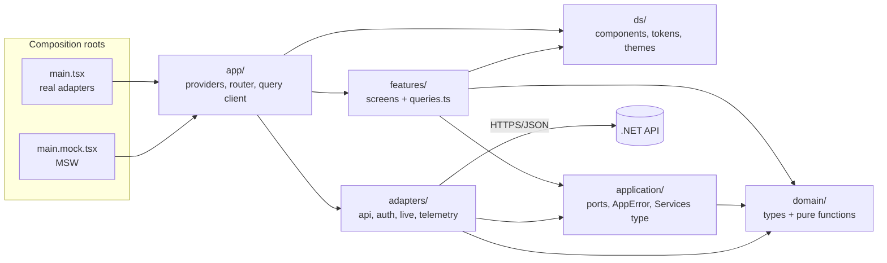

**Status: applied 2026-10-19** (docs-sync stage, owner-approved; nothing committed). Outcome: ADRs 0010-0018 as nine merged ADRs, ADR 0001 and 0002 superseded, owner decisions F-1 to F-5, F-10 and F-11 as stated; F-6 to F-9 and F-12 taken from the recommendations; A4 not applied (superseded by C-1). The text below is the proposal as approved and is not updated; where it differs (ADR numbers 0010-0021, `components/index.md`, K1-K29), the `.okf` pages are the record.

# Step 1 review fixes + architecture decisions: proposed `.okf` changes (applied, see status above)

Spec/plan stage only. Nothing under `web-react/.okf`, `src` or any tracked file was edited; this file is the only thing written.
Supersedes `20261019-step1-okf-proposal.md` (Part A below keeps its 10 items unchanged, except where Part C says an item is affected).
After applying anything: `pnpm okf`. Every page is shown to you first; nothing is committed.

Layout:
* **Part A** - the 10 step 1 items (A1-A10).
* **Part B** - architecture decisions D1-D12 as proposed ADRs 0010-0021, with constraints.
* **Part C** - conflicts with existing ADRs and with Part A, and what I found while checking the decisions against each other.
* **Part D** - mapping to `bootstrap-plan.md` steps, and the list of `.okf` files that would change.
* **Part E** - C4 L3 draft.
* **Part F** - open questions.

---

# Part A - Step 1 review fixes (unchanged from the step 1 proposal)

## A1. Rename `architecture/system-context.md` -> `architecture/context.md`

Run `git mv .okf/architecture/system-context.md .okf/architecture/context.md`, then update links:

| File | Change |
|---|---|
| `.okf/architecture/index.md` | `(system-context.md)` -> `(context.md)` |
| `.okf/index.md` line 9 | `(architecture/system-context.md)` -> `(architecture/context.md)` |
| `.okf/map.md` line 26 | `[architecture/system-context.md](architecture/system-context.md)` -> `[architecture/context.md](architecture/context.md)` |
| `.okf/log.md` line 4 | `(architecture/system-context.md)` -> `(architecture/context.md)` |
| `.okf/backlog/bootstrap-plan.md` ("C4 mapping") | `` `system-context.md` `` -> `` `context.md` `` |

Keep the page `title: "System Context"` (only the filename changes) so link text stays valid.

## A2. New full contents of `architecture/context.md` (L1)

```markdown
---
type: System Context
title: "System Context"
description: "C4 level 1 - the user, the web SPA and the external systems it depends on."
resource: package.json
tags: [c4, context, react]
status: draft
---
# System Context

## The system
A **single-page web app** (React, TypeScript) built as a clean-architecture starter. The business capability is yours
to add; the starter will ship one example slice, Emails, served by the same REST surface as the Flutter stack. An
OpenAPI file for that surface is planned ([ADR 0008](../adr/0008-openapi-contract-as-single-schema-source.md)).

## Who uses it
| Actor | Interaction |
|---|---|
| **End user** | Uses the [web SPA](containers.md) in a browser; signs in with the identity provider |
| **Developer** | Builds on the starter; reads this bundle first |

## External systems
| System | Role | Status |
|---|---|---|
| **.NET API** | Source of truth for emails over HTTPS/JSON | Not in this repo. Contract: [ADR 0008](../adr/0008-openapi-contract-as-single-schema-source.md) |
| **Identity provider** | Authenticates the end user; the API validates the result and issues the session | Placeholder until each project picks one; cookie issuing is the API's job ([ADR 0009](../adr/0009-cookie-session-and-csrf-owned-by-the-api.md)) |

## Relationships
* End user -> Web SPA: uses in a browser.
* End user -> Identity provider: signs in.
* Web SPA -> .NET API: HTTPS/JSON.
* .NET API -> Identity provider: validates sign-in results only.

## Boundaries
Everything under `web-react/` is this system. Other stacks in the monorepo have their own folders and bundles.

## Unverified
* The REST surface shared with Flutter is not yet written down as an OpenAPI file (planned, step 4).
* The identity provider, sign-in flow and session cookie behaviour are not chosen or implemented.
```

(Removed: "TanStack Query for server state, and structural rules enforced by lint and tests" - in-SPA tech belongs to L2/L3, not L1.)

## A3. `architecture/containers.md` (L2)

Full new contents (Part C-5 proposes one added row under "Test doubles"; the version below is the original):

````markdown
---
type: Container
title: "Containers"
description: "C4 level 2 - the web SPA and the .NET API; test doubles are listed separately."
resource: package.json
tags: [c4, container, react]
status: draft
---
# Containers

| Container | Technology | Role | In this repo |
|---|---|---|---|
| **Web SPA** | Vite build, React 19, TypeScript; static files on hosting or a CDN | Runs in the browser; talks HTTPS/JSON to the API. Sends `credentials: 'include'` (planned, step 10) | Yes, `web-react/` |
| **.NET API** | ASP.NET | Business data, sessions and CSRF validation ([ADR 0009](../adr/0009-cookie-session-and-csrf-owned-by-the-api.md)); validates sign-in results from the identity provider | No |
| **Identity provider** | Chosen per project | Authenticates the end user in the browser | No |

```
Browser (Web SPA) ──sign-in──> Identity provider
   │
   └──HTTPS/JSON──> .NET API ──validation only──> Identity provider
Hosting / CDN ──(static files)──> Browser
```

## Test doubles (not deployed)
| Double | Technology | Used by |
|---|---|---|
| **Mock API** | MSW | Integration tests and the e2e smoke run. Planned, see [plan](../backlog/bootstrap-plan.md) |

The SPA has no server of its own: there is no SSR and no backend-for-frontend inside this stack.
Layers inside the SPA (C4 level 3) are documented when they are built.

## Unverified
* `credentials: 'include'` and the sign-in redirect are planned, not implemented.
````

## A4. ADR 0001 - add a sentence at the end of `## Decision`
```diff
+Enforcement is not in place yet: the `src/` layers and the boundaries lint land in step 3 of the
+[bootstrap plan](../backlog/bootstrap-plan.md); until then this ADR describes the target.
```
**Affected by Part B**: if ADR 0010 is accepted, ADR 0001's layer set is superseded. See C-1 for the replacement edit.

## A5. ADR 0006 - `## Decision`
```diff
-Lint, typecheck, tests and build must pass before a change is complete. TypeScript is pinned to 6.0.3.
+Format check (`prettier --check`), lint, typecheck, tests and build must pass before a change is complete
+(`pnpm check` runs all of them plus `okf.py --check`). TypeScript is pinned to 6.0.3.
```
Also in ADR 0006 `Consequences`: "`typescript-eslint` 8.71.2 rejects TypeScript 7" -> "`typescript-eslint` 8.71.2 declares a peer range that excludes TypeScript 7" (same softening as A9).

## A6. ADR 0007 - `## Decision`, replace the last sentence of the paragraph
```diff
-Line coverage of non-generated code must be at least
-80% in CI. The e2e job runs after the build and is required on pull requests to `main`.
+Line coverage of non-generated code must be at least 80%. Today the threshold is enforced locally by
+`vitest.config.ts` (`coverage.thresholds`, run with `pnpm test:coverage`); the minimal CI gate (lint, typecheck,
+test, build) arrives in step 2 and the coverage, `okf.py` and e2e jobs in step 12. The e2e job runs after the build
+and is required on pull requests to `main`.
```
**Affected by Part B**: D11 (CI) moves coverage and `okf.py` into step 2. See C-2 for the replacement wording.

## A7. `adr/_template-adr.md` - in the YAML example
```diff
-title: "ADR 0009: Short imperative statement of the decision"
+title: "ADR NNNN: Short imperative statement of the decision"
```

## A8. `backlog/bootstrap-plan.md`
```diff
-**Status.** Decisions recorded; step 1 in review. Nothing below is built. Delete this file when the last step is done and log it.
+**Status.** Step 1 done (scaffold, review fixes, ADRs 0001-0009). Steps 2-13 are not built. Delete this file when the last step is done and log it.
```
Step-12 row:
```diff
-| 12 | CI | ... | `ci: add web-react workflow` |
+| 12 | CI | ... | `ci: extend web-react workflow` |
```
Enforcement wording (so ADRs do not claim more than exists):
* Step 3 row: add "ADR 0001 enforcement starts here."
* Step 9 row: add "Coverage threshold (ADR 0007) is checked by `pnpm test:coverage`."
* Step 12 row: add "CI enforces `okf.py --check` and the coverage threshold."
* In "C4 mapping": `` `system-context.md` `` -> `` `context.md` ``; L1/L2 "(done in step 1)" -> "(draft from step 1)"; L2 "Mock API (MSW, test only)" -> "Test doubles (MSW, not deployed)".
* Decision 9 mentions "No co-author trailers or generated markers" - unchanged.

**Affected by Part B**: nearly every row of the plan changes. Part D gives the full replacement; A8 is the minimum if Part B is rejected.

## A9. `backlog/typescript-7-upgrade.md` - peer range wording
```diff
-**Problem.** `typescript-eslint` 8.71.2 accepts TypeScript `>=4.8.4 <6.1.0` and throws on 7.0 ([ADR 0006](...)).
+**Problem.** The installed `typescript-eslint` 8.71.2 declares a TypeScript peer range of `>=4.8.4 <6.1.0`, which excludes 7.0
+([ADR 0006](../adr/0006-strict-typescript-and-lint.md)). Re-check the range when bumping; do not rely on this number.
```

## A10. `log.md` - new line under `## 2026-10-19`
```markdown
* **Update**: Step 1 review fixes: renamed `system-context.md` to [context.md](architecture/context.md); L1 and L2 pages set to draft with Unverified notes and the identity-provider flow; MSW listed as a test double; ADRs [0001](adr/0001-layers-and-boundaries.md), [0006](adr/0006-strict-typescript-and-lint.md), [0007](adr/0007-test-tiers-and-coverage.md) and the ADR template aligned with what is enforced today; [bootstrap plan](backlog/bootstrap-plan.md) status and step 12 commit message corrected.
```
Notes: `status: draft` pages on L1/L2 must still pass `okf.py --check`. `map.md` descriptions for `containers.md` should match its new `description`.

---

# Part B - Architecture decisions

Numbering continues from 0009. Every ADR below would be written as `status: draft` in the proposal stage, then `stable` once accepted, using `_template-adr.md` (Context, Decision, Consequences, Alternatives rejected, When to revisit). I give the decision text and what it replaces; full ADR bodies are written after you approve the list (C-8 suggests merging some).

Existing decisions respected and not reopened: Vite, TanStack Router and Query, CSS Modules (no Tailwind, plan decision 5), orval + one OpenAPI file ([ADR 0008](../adr/0008-openapi-contract-as-single-schema-source.md)), no Zustand ([ADR 0003](../adr/0003-state-management.md)), TypeScript pinned to 6.0.3, cookie session owned by the API (ADR 0009).

## D1. Hexagonal layers -> ADR 0010 "Hexagonal layers, two composition roots"

| Folder | Holds | Imports from npm |
|---|---|---|
| `domain/` | Pure types and functions (entities, value objects, `Result<T, E>`, constructors, rules) | none of React, TanStack, zod, i18next, fetch clients |
| `application/` | Ports (one interface per resource), `AppError`, the `Services` type, `Logger` / `CrashReporter` ports. Ports return `Promise<Result<T, AppError>>` | none of the same list |
| `adapters/` | Port implementations: `api/` (orval client, zod parsing, mappers, HTTP client), `auth/`, `live/`, `telemetry/` | fetch, zod, orval output |
| `ds/` | Design system components, CSS Modules, design tokens as CSS variables; light/dark through `[data-theme]` | React |
| `features/<name>/` | Screens, feature components, `queries.ts` | React, TanStack, i18next |
| `app/` | Providers, router, query client, theme and i18n setup | everything |

Composition roots: `main.tsx` builds the real adapters; `main.mock.tsx` builds the same `Services` with MSW behind the same API adapter. Both call one shared `app/` bootstrap so the two cannot drift.

Replaces: the `ui / domain / data / config / utils` set of [ADR 0001](../adr/0001-layers-and-boundaries.md) (see C-1). Keeps from ADR 0001: one OKF bundle per stack, the lint-enforced direction idea.

Constraints:
* K1. `domain/` and `application/` contain no framework imports (React, TanStack, zod, i18next, router, MSW).
* K2. Only `adapters/` performs I/O (fetch, storage, EventSource).
* K3. Only `main.tsx` and `main.mock.tsx` choose concrete adapters.
* K4. `ds/` is the only folder with `*.module.css` files and token declarations. Features compose ds components and have no CSS of their own (see F-4).
* K5. Generated orval output lives inside `adapters/api/` (git-ignored, excluded from lint, coverage, docs and `okf.py`, ADR 0006).

## D2. Boundaries lint with an allow-matrix -> ADR 0011 "eslint-plugin-boundaries allow-matrix"

Enforced from step 3. Rows import columns:

| from \ to | domain | application | adapters | ds | features | app |
|---|---|---|---|---|---|---|
| `domain` | self | no | no | no | no | no |
| `application` | yes | self | no | no | no | no |
| `adapters` | yes | yes | self | no | no | no |
| `ds` | no | no | no | self | no | no |
| `features` | yes | yes | no | yes | self only (no cross-feature) | no (see C-3) |
| `app` | yes | yes | yes | yes | yes | self |

Plus: `src/test/**` and `*.test.*` may import everything; `main.tsx` / `main.mock.tsx` count as `app`. Cross-feature imports are not in your list; I propose forbidding them (a feature imports itself, not a sibling) - confirm in F-5.

Constraints:
* K6. The matrix is the contract; the architecture test of the old step 3 shrinks to a rule self-test (a fixture per forbidden edge, including `@/` alias, `import type`, and dynamic `import()`), because the lint resolves static imports only (existing risk in the plan).
* K7. A new top-level folder under `src/` needs a matrix row before it lands.

## D3. Dependency injection -> ADR 0012 "ServicesContext and one port per resource"

* `application/` defines `interface EmailsPort`, `SessionService`, `Logger`, `CrashReporter`, ... and `type Services = { emails: EmailsPort; session: SessionService; ... }`.
* Adapters are factory functions: `createEmailsApi(http): EmailsPort`; no classes with hidden state, no singletons at module load.
* `app/` provides `ServicesContext`; `useServices()` is the only way a feature gets a service (no imports from `adapters/`, already barred by the matrix).
* Router loaders and `queryOptions` receive services explicitly (from router context), never by calling a hook.

Constraints:
* K8. One port per resource, named for the resource (`EmailsPort`), not per use case. No repository + use-case pair unless logic needs it.
* K9. Nothing outside the composition roots calls an adapter factory (tests excepted, for adapter tests).

Replaces wording in [ADR 0003](../adr/0003-state-management.md) ("repositories fetch ... view-model hooks"): ports and `queries.ts` replace repositories and view-model hooks. See C-4.

## D4. Errors -> ADR 0013 "Adapters never throw; AppError is a closed union"

```ts
type AppError = {
  kind: 'refused' | 'unauthorized' | 'network' | 'invalid';
  status?: number;
  code?: string;
};
```
* Adapters map HTTP failures, network failures and zod parse failures to `Err(AppError)`. They never throw for expected outcomes.
* `kind` mapping (proposal, confirm in F-6): 401 -> `unauthorized`; other 4xx -> `refused`; fetch failure, timeout, 5xx -> `network`; zod or shape failure -> `invalid`.
* `code` is the API's stable error code; it maps to an i18n key in one helper (D8).
* Bugs and faults still throw and reach the global error hooks and `errorComponent`s.

Supersedes [ADR 0002](../adr/0002-result-over-exceptions.md) (type names change from `Success`/`Failure` + coded `AppError` to `Ok`/`Err` + `kind`; the "no throwing across layers" principle stays). See C-1.

Constraints:
* K10. `fetch`/`ky`-style calls and `JSON.parse` appear only in `adapters/`, each wrapped so the port returns `Result`.
* K11. `queries.ts` is the one place a `Result` is unwrapped for TanStack Query: `Err` becomes a thrown `QueryError` carrying the `AppError` (see C-6, an error must be thrown for Query to see a failure, and `@typescript-eslint/only-throw-error` rejects plain objects).
* K12. `Result<T, E>` itself is generic and lives in `domain/`; `AppError` lives in `application/` (it is the port contract, `status` is transport-flavoured).

## D5. Query defaults -> ADR 0014 "TanStack Query defaults"

* `QueryClient` defaults: `retry: (count, error) => error is 4xx ? false : count < 2`; mutations `retry: false`; `refetchOnWindowFocus: false`.
* Per feature: query key constants (`emailKeys.all`, `emailKeys.list(filter)`), `queryOptions()` factories in `queries.ts`, mutations invalidate in `onSettled` (not `onSuccess`).

Amends [ADR 0003](../adr/0003-state-management.md) (adds defaults; no contradiction). Cleaner as a new ADR than as an edit, since 0003 is accepted.

Constraints:
* K13. Keys are built from per-feature constants only; no inline array literals in components (a lint rule or the `@tanstack/query` plugin's key rules cover part of this).
* K14. Whether `kind: 'invalid'` retries is not in your list. I propose no retry (parse failures are deterministic) - F-6.

## D6. Routing -> ADR 0015 "Router context, guards in beforeLoad, loaders prefetch"

* TanStack Router with typed context `{ queryClient, services, session }`.
* Auth check in `beforeLoad` of the authenticated layout route (redirect to sign-in).
* Loaders call `queryClient.ensureQueryData(feature.queryOptions(services))`; components read the same options with `useSuspenseQuery` / `useQuery`.
* `errorComponent` on the root route and on the shell route (nested, so the shell/navigation survives a page error); `notFound` handling at root.

Builds on [ADR 0004](../adr/0004-tanstack-router.md) (extends it; ADR 0004 itself needs no edit, only a "See also"). Route definitions live in `app/`, which may import feature screens and `queries.ts` (matrix row `app`).

Constraints:
* K15. Guards live in `beforeLoad`, never in component effects.
* K16. Loaders never read services from a hook; they use router context.

## D7. Session -> ADR 0016 "SessionService and a single 401 handler"

* `SessionService` is a port in `application/` (current session snapshot, `bootstrap()`, `signOut()`, subscribe). Adapter in `adapters/auth/`.
* The HTTP client in `adapters/api/` is the single place that reacts to 401: it maps to `unauthorized`, calls `session.expire()` once, and the router guard redirects. Screens never handle 401 (this is the web form of the Flutter "urgent failure handler", per the plan).
* Start-up guard for React `StrictMode` double invocation: session bootstrap runs once (promise memoised in the adapter / started from router `beforeLoad`, not from a bare `useEffect`).

Builds on [ADR 0009](../adr/0009-cookie-session-and-csrf-owned-by-the-api.md): no tokens in JS storage; the session snapshot holds user info only.

Constraints:
* K17. No `status === 401` check outside the HTTP client.
* K18. Any adapter that starts something on mount (session, live connection) must be idempotent under double start.

## D8. i18n -> ADR 0017 "i18n keys derived from en.json"

* `en.json` is the source; `TranslationKey` is derived from it (i18next resource type augmentation, or `keyof` of the imported JSON), so a missing key is a type error.
* A test checks that every other locale has exactly the keys of `en.json` (key parity, both directions).
* `AppError` -> key helper: `errors.<kind>` with optional `errors.<kind>.<code>`; one function, used by every screen.

Constraints:
* K19. User-visible strings in `features/` and `ds/` come from keys; `ds/` takes already-translated props (it has no i18n dependency, matrix `ds -> none`).
* K20. Locale JSON lives outside the matrix layers (F-3).

## D9. Tooling and lint -> ADR 0018 "Compiler flags, alias and lint rule set"

* Already true in the repo: `noUncheckedIndexedAccess`, `exactOptionalPropertyTypes`, `verbatimModuleSyntax` are set in `tsconfig.json`. Nothing to change for these three.
* Add: `@/` -> `src/` alias in `tsconfig.json` (`paths`), `vite.config.ts` (`resolve.alias`) and so in `vitest.config.ts` (it merges the vite config).
* `pnpm check` = `format:check`, `lint`, `typecheck`, `test:coverage`, `build`, `okf`. Today `check` runs `pnpm test`, not `test:coverage`: one-word change, in step 2.
* Lint rules: named exports only (`import/no-default-export` or `no-restricted-syntax`; route files and configs excepted if needed), no `enum` (`no-restricted-syntax` on `TSEnumDeclaration`), no `as unknown as` (`no-restricted-syntax` on the nested assertion), no inline `style` prop (`react/forbid-dom-props` or `no-restricted-syntax` on `JSXAttribute[name.name=style]`), `eqeqeq`, `no-console` with `warn` and `error` allowed, `jsx-a11y` strict, `react-hooks` (already installed), `@tanstack/eslint-plugin-query`, `@vitest/eslint-plugin`.

Extends [ADR 0006](../adr/0006-strict-typescript-and-lint.md). New dev dependencies (not added now): `eslint-plugin-boundaries`, `eslint-plugin-jsx-a11y`, `@tanstack/eslint-plugin-query`, `@vitest/eslint-plugin`, and one of `eslint-plugin-import-x` / built-in rules for the default-export ban. Confirm each supports ESLint 10 flat config at install time (not verified).

Constraints:
* K21. Rule exceptions are scoped by file glob in `eslint.config.js`, never by `eslint-disable` without a comment naming the reason.
* K22. Default exports are allowed only where a tool requires them (`*.config.ts`, and any file TanStack Router's file-based generation needs, if it is used; code-based routes avoid that).

## D10. Testing -> ADR 0019 "Test harness: real providers, typed fakes, MSW"

* `renderWithProviders(ui, overrides)` in `src/test/`: real `QueryClient` (retries off), real router with memory history, real i18n, real `ServicesContext` whose value is `defaultFakes` merged with `overrides` (partial per port).
* One typed fake per port (`createFakeEmails(overrides?)`), hand-written, no mock framework (already in ADR 0007).
* MSW: orval-generated mock handlers plus a hand-written seed for adapter tests and `dev:mock`.
* `dev:mock` script runs Vite with `main.mock.tsx`; Playwright runs against mock mode.
* Global settings: `StrictMode` wrapped in `renderWithProviders`, and async timeout 3 s (`asyncUtilTimeout` in Testing Library config / `testTimeout` as applicable).

Extends [ADR 0007](../adr/0007-test-tiers-and-coverage.md): "repositories" -> "ports"; "built app with MSW" -> "mock mode build/dev server". See C-2, C-7.

Constraints:
* K23. Component tests never mock `fetch` or an adapter module; they pass a fake port. Adapter tests never use fakes; they use MSW.
* K24. `main.mock.tsx` and MSW must not end up in the production bundle (check in step 9: grep the built `dist/` for `msw`; or build mock mode into a separate outDir).

## D11. CI -> ADR 0020 "One reusable CI workflow runs pnpm check"

* Reusable workflow (`workflow_call`) so the same job can be called per push, pull request and merge queue: `pnpm install --frozen-lockfile`, `pnpm audit`, `pnpm check`.
* `actions/setup-node` with `node-version-file: web-react/.nvmrc` (file exists); corepack for pnpm.
* `concurrency` with `cancel-in-progress: true`, `permissions: contents: read`, `paths` filters for `web-react/**` and the workflow file, `merge_group` trigger.
* Playwright is a separate job, added later (plan step 9/12), required on PRs to `main` per ADR 0007.

Extends ADR 0007 and the plan's CI rows. Constraints:
* K25. Workflow actions pinned to a major version at least; no `pull_request_target`; no secrets used.
* K26. A path-filtered workflow that is a *required* status check leaves pull requests that touch only other stacks "pending" forever; a merge-queue + required check needs a same-named always-run job or a gate job (F-8).

## D12. Deploy (later step) -> ADR 0021 "Runtime /env.js and unprivileged nginx"

* The built SPA reads runtime config from `/env.js` (served by the container, not baked at build), parsed once at boot with zod; boot fails fast with a visible error page if invalid. This changes the plan's "`import.meta.env` parsed by zod in `config/env.ts`" (step 7): build-time `VITE_*` stays for dev and mock mode only.
* Image: `nginx-unprivileged`; an entrypoint writes `env.js` and the nginx config including the CSP at container start from environment variables.
* Realtime: an SSE-over-fetch `live` port in `application/` with an adapter in `adapters/live/` is **optional**. I propose a backlog page (`backlog/realtime-live-port.md`), not an ADR, until a feature needs it.

Constraints:
* K27. `env.js` holds public values only (ADR 0009, plan S1).
* K28. CSP is generated at start from the same env as `env.js`, so `connect-src` always matches the API URL. Plan S2/S5 already ask for CSP documentation; this makes it executable.
* K29. `env.js` loaded before the app module; boot has one failure path (no partially started app).

---

# Part C - Conflicts and findings from cross-checking

C-1. **ADR 0001 and 0002 are superseded, not edited** (the ADR index says "Supersede an accepted ADR rather than editing it"). Replacement for A4: do not add the "enforcement not in place" sentence; instead ADR 0010 states "Supersedes ADR 0001 (layer set); the one-bundle-per-stack decision remains in force", ADR 0013 states "Supersedes ADR 0002", and both old ADRs get `status: deprecated` plus one line pointing to the successor (a status-and-pointer edit, the only edit the index convention allows). Note ADR 0001 mixes two decisions (layers, bundle per stack); a clean supersede may want a small ADR split or an explicit "partially superseded" line - your call (F-1).

C-2. **A6 / ADR 0007 wording changes.** D11 puts the coverage threshold and `okf.py` into step 2's `pnpm check`, so the A6 sentence ("coverage, `okf.py` and e2e jobs in step 12") becomes: "the CI gate runs `pnpm check`, which includes the coverage threshold and `okf.py`, from step 2; the e2e job is added in step 9/12". Also ADR 0007 says "hand-written fakes for repositories" -> "for ports" and "against the built app with MSW" -> "against mock mode" (new ADR 0019 carries this; ADR 0007 gets a "See also" line, not a rewrite).

C-3. **Real conflict: `useServices()` cannot live where the matrix puts it.** `application/` may not import React, so `ServicesContext` and `useServices()` cannot be in `application/`. `features/` may only import `application`, `domain`, `ds`, so it cannot import them from `app/` either. Options:
  1. Put the `Services` *type* in `application/` and the context + hook in `app/services-context.ts`, with a single matrix exception "features may import `app/services-context`" (smallest change; one more row cell).
  2. A small `src/di/` folder (React-bound) importable by `features` and `app`.
  3. Pass services via TanStack Router context only and give features props/loaders.
  I recommend option 1. It does change your matrix by one entry, so it needs your decision (F-2). The same issue applies to `useSession()` and any other app-wide hook.

C-4. **ADR 0003 wording** ("repositories fetch, view-model hooks read") and plan rows "repositories context", "view-model hook" are replaced by "ports" and `queries.ts`. ADR 0003's principle (Query owns server state, no store) is intact; I propose a "See also ADR 0014" line only.

C-5. **A3 / containers.md** - D1/D12 add nothing to L2 except the optional container "nginx-unprivileged image serving static files + `env.js`" (a hosting detail, step 14). Not added now (A3 already says "static files on hosting or a CDN"); it becomes a row when D12 lands, and `main.mock.tsx` + MSW is already a "Test doubles" row.

C-6. **Hidden requirement: TanStack Query needs a thrown error.** "Adapters never throw" holds, but `queryFn` must throw for Query to mark an error and apply the retry rule, so `queries.ts` unwraps `Err` into a `QueryError extends Error { appError }`. The retry function reads `error.appError.status`. Small helper in `application/` (pure; `Error` subclass, no framework). Needs documenting in ADR 0013/0014 or the "no throwing" statement reads as contradicted.

C-7. **Playwright "against mock mode" vs ADR 0007 "built app with MSW".** Equivalent only if mock mode can be built (`vite build --mode mock`) or served (`vite --mode mock`). Dev-server Playwright is faster to set up but tests the dev bundle, not the production build; I suggest `vite build --mode mock` + `vite preview` in CI. Needs your call (F-7).

C-8. **Twelve ADRs is a lot to review.** Recommended merges: 0011 into 0010; 0012 (DI) into 0010; 0015 (query defaults) and 0016 (routing) as one "data loading and routing" ADR; 0019 (tooling) folded into a *supersede* of 0006 (so 0006 stays accurate); 0021 (deploy) written only when step 14 starts. That leaves 0010, 0012 (DS), 0013 (errors), 0014 (query+routing), 0015 (session), 0016 (i18n), 0017 (tooling, supersedes 0006), 0018 (tests, supersedes 0007), 0019 (CI). The list in Part B stays one-per-decision so that each decision is visible; the merge is your choice (F-9).

C-9. **The `ds/` rule is strict.** "ds/ only place with CSS Modules" plus "no inline style" means a feature cannot have a one-off layout class. Features would need ds layout primitives (`Stack`, `Inline`, `Page`, `Card`...). That is a good constraint but makes the first ds components part of step 7/8, not decoration (F-4).

C-10. **`pnpm audit` as a required gate can fail unrelated pull requests** when a new advisory lands. Plan step 10 says `pnpm audit --prod` blocks merge. I propose `pnpm audit --prod --audit-level=high` in the step 2 workflow, and the plan's step 10 wording changes to "already gated since step 2" (F-10).

C-11. **The plan's Flutter-mirroring table (rows 15-18, 21-22)** names `ui/data/config/utils`, "repositories context", `config/env.ts`. Those rows are rewritten in D (below).

---

# Part D - Mapping to `bootstrap-plan.md` and `.okf` change list

## D-1. Decision -> plan step

Plan numbers are the existing 1-13; `14` is new (see F-11).

| Item | Step | What lands in that step |
|---|---|---|
| A1-A10 | 1 (review fixes) | As Part A; A4, A6, A8 modified by C-1, C-2 and the table below |
| D1 layers + roots | 3 (folders, matrix); `main.tsx` exists; `main.mock.tsx` skeleton in 5 | Empty `src/{domain,application,adapters,ds,features,app}` with one real file each, not placeholder folders |
| D2 boundaries lint | 3 | `eslint-plugin-boundaries` config, allow-matrix, rule self-test fixtures (including alias and `import type`) |
| D3 DI | 5 | `Services` type (needs ports from 2/4), `ServicesContext`, `useServices`, `QueryClient`, `renderWithProviders`, typed fakes |
| D4 errors | 2 (`Result`, `AppError`, `QueryError`, `Logger`/`CrashReporter` ports) and 4 (HTTP client mapping, zod -> `invalid`) | Unit tests for every `kind` mapping |
| D5 query defaults | 5 | Default options in `app/` query client; key + `queryOptions` pattern shown by Emails in 8 |
| D6 routing | 6 | Router with context, `beforeLoad` guard, `errorComponent` (root + shell), `notFound`; loaders in 8 |
| D7 session | 6 (`SessionService` port + fake + guard + double-start guard); 10 (real adapter, single 401 handler, CSRF hook) | 401 handler needs the HTTP client from 4, so it is *tested* in 10 |
| D8 i18n | 7 | `en.json`, `TranslationKey`, key-parity test, error-key helper |
| D9 tooling | 2 (`check` script, `@/` alias, TS flags already done), 3 (boundaries), 7 (a11y, query, vitest plugins as the code they lint appears) | Add each lint plugin in the step where it has code to check, so no step ships rules with nothing to lint |
| D10 testing | 5 (`renderWithProviders`, fakes, StrictMode, timeout), 4 (MSW handlers via orval), 9 (adapter MSW tests, `dev:mock` finalised, Playwright) | `dev:mock` needs `main.mock.tsx` (5) and handlers (4) |
| D11 CI | 2 (reusable workflow with `pnpm check`, audit); Playwright job 9/12 | Step 12 shrinks to: Playwright job, Dependabot, pre-commit extension |
| D12 deploy | new step 14 (after 13) | `/env.js` boot validation, nginx-unprivileged image, CSP at start; README deploy section added when it lands |
| Realtime live port | backlog page now (optional); a step only when a feature needs it | - |

## D-2. Replacement plan rows (summary; full text is written when you approve)

| # | Step | Changed content |
|---|---|---|
| 2 | Core and minimal CI | `Result<T,E>` (domain), `AppError`, `QueryError`, `Logger`, `CrashReporter` (application). Reusable `web-react.yml`. `check` uses `test:coverage`; `@/` alias. |
| 3 | Layers and boundaries | Six folders, matrix, self-test. C4 L3 overview page written here. |
| 4 | API client | As today, plus `adapters/api/` placement, orval mock output, HTTP client with error mapping. |
| 5 | DI and state | `Services`, context, `useServices`, `QueryClient` defaults, `renderWithProviders`, fakes, `main.mock.tsx`. |
| 6 | Routing and session | Typed context, guard, error/not-found components, `SessionService` port. |
| 7 | Cross-cutting | i18n, ds tokens + theme (`[data-theme]`), first ds primitives, lint plugins that now have code, error boundaries to `CrashReporter`. Env stays build-time here (runtime in 14). |
| 8 | Sample feature | Emails: domain, port, adapter, `queries.ts`, screen, route, strings; no view-model hook/use-case/repository terms. |
| 9 | Quality | Adapter MSW tests, `dev:mock`, Playwright against mock mode, bundle check K24. |
| 10 | Security baseline | As today; `pnpm audit` already gated; real session adapter and single 401 handler tested. |
| 11 | `.okf` content | L3 per-layer pages, ADR text for any not yet written, constraints, conventions. |
| 12 | CI | Playwright job, Dependabot entry, pre-commit extension. (`okf.py --check` and coverage already run via `pnpm check`.) |
| 13 | Docs | README. |
| 14 | Deploy (new) | D12. |

Also: rewrite plan "What flutter/ gives us to mirror" rows (layers, `Result`, providers, view-model, `config/env.ts`, CI) and the C4 mapping L3 line to the new layers; add risks: C-3, C-6, K24, K26, and "lint plugin ESLint 10 compatibility unverified".

## D-3. `.okf` files that would change

| File | Change | When |
|---|---|---|
| `adr/0010`-`0021` (new, 12 or merged per C-8) | New ADRs, `status: draft` -> `stable` | Written when each step starts, except 0010/0011 with step 3 |
| `adr/0001-layers-and-boundaries.md` | `status: deprecated`, pointer to 0010 (C-1) | With 0010 |
| `adr/0002-result-over-exceptions.md` | `status: deprecated`, pointer to 0013 | With 0013 |
| `adr/0003-state-management.md` | "See also" line only | With 0014 |
| `adr/0004-tanstack-router.md` | "See also" line only | With 0015 |
| `adr/0006-strict-typescript-and-lint.md` | A5 edits; "See also" (or supersede per C-8) | Step 1 / 7 |
| `adr/0007-test-tiers-and-coverage.md` | A6 edits (revised by C-2); "See also" | Step 1 / 5 |
| `adr/0009-cookie-session-and-csrf-owned-by-the-api.md` | "See also" to session ADR | With 0016 |
| `adr/index.md` | New ADR rows | With each ADR |
| `adr/_template-adr.md` | A7 | Step 1 |
| `architecture/context.md` (renamed) | A1, A2 | Step 1 |
| `architecture/containers.md` | A3; later a hosting row for D12 | Step 1 / 14 |
| `architecture/components/` (new): `index.md` overview + one page per layer | L3 (Part E) | Overview in step 3, layer pages in 11 |
| `architecture/index.md`, `index.md`, `map.md` | Link renames (A1), new pages | Per change |
| `engineering/constraints.md` (new) | K1-K29, grouped by layer (a page the plan lists as "constraints" in step 11) | Step 11, with each K added in the step that enforces it |
| `engineering/` conventions pages (new, small): lint rules, testing harness | Step 11 | |
| `backlog/bootstrap-plan.md` | A8 plus Part D-2 | Step 1 (A8) and now (D-2), once you approve |
| `backlog/typescript-7-upgrade.md` | A9 | Step 1 |
| `backlog/realtime-live-port.md` (new) | Optional SSE-over-fetch port | With D12 decision |
| `log.md` | A10 plus one line per later change | Per change |
| `tools/okf.py` | no change | - |

Non-`.okf` files that the steps will touch (listed because the plan's "Shared files" section needs them): `tsconfig.json`/`vite.config.ts`/`vitest.config.ts` (alias), `eslint.config.js`, `package.json` (check script, new dev dependencies), `.github/workflows/web-react.yml` (new, step 2), `.github/dependabot.yml`, `.githooks/pre-commit`. None edited now.

---

# Part E - C4 L3 draft (`architecture/components/index.md`, written in step 3)

`resource:` must exist when the page is written (okf.py checks it), and `src/` folders only exist from step 3. Use `eslint.config.js` (holds the matrix) as `resource`.

````markdown
---
type: Component
title: "Components (Web SPA)"
description: "C4 level 3 - the layers inside the web SPA and the allowed dependency directions."
resource: eslint.config.js
tags: [c4, components, react, layers]
status: draft
---
# Components (Web SPA)

Layers are folders under `src/`. Arrows are the only allowed imports; `eslint-plugin-boundaries` enforces them
([ADR 0011](../../adr/0011-boundaries-allow-matrix.md)).



| Component | Responsibility | Imports | Never |
|---|---|---|---|
| `domain` | Entities, value objects, `Result` | nothing | frameworks, I/O |
| `application` | One port per resource, `AppError`, `Services` | `domain` | frameworks, I/O |
| `adapters` | Implement ports; map HTTP/zod failures to `Err` | `application`, `domain` | throw for expected failures; be imported by features |
| `ds` | Components, CSS Modules, tokens, light/dark via `[data-theme]` | nothing | know the domain |
| `features` | Screens, `queries.ts` (keys, `queryOptions`, mutations) | `application`, `domain`, `ds`; services via `useServices()` | import adapters, other features |
| `app` | Providers, router (typed context), query client, theme, i18n | all | hold business rules |

## Unverified
* The folders and the lint rules are planned (step 3); `useServices()` placement is open ([C-3](../../../.factory/runs/20261019-architecture-okf-proposal.md)).
````

(Before writing the page, the link to this run file is removed - it is a working document and `.factory` is not part of the bundle. The line above shows the open point only.)

L4 follow-ups already in the plan stay: key types on the layer pages (`Result`, `AppError`, ports) and one Emails sequence diagram (screen -> `queries.ts` -> port -> adapter -> API) - the view-model hook step of the old sequence disappears.

---

# Part F - Open questions (my recommendation first)

* F-1. ADR 0001 mixes layers and bundle-per-stack. Mark it `deprecated` entirely and restate the bundle rule in ADR 0010, or keep it `stable` with a "partially superseded by 0010" note? *Recommend: the second; fewer moving parts.*
* F-2. `useServices()` / `ServicesContext` home (C-3). *Recommend: option 1, context in `app/`, one matrix exception for `features`.*
* F-3. Where do `en.json` and other locale files live? They are data, not a layer. *Recommend: `src/locales/`, importable by `app/` and tests only, listed in the matrix.*
* F-4. Is the "ds is the only place with CSS" rule meant to forbid feature-level CSS Modules completely (so features use ds layout primitives)? *Recommend: yes; it needs `Stack`/`Inline`/`Page` primitives in step 7.*
* F-5. Cross-feature imports: forbidden (my proposal), or allowed through a feature's `index.ts` only?
* F-6. `AppError.kind` mapping: 403 -> `refused` or `unauthorized`? 5xx -> `network` or a fifth kind? Does `invalid` retry (I say no)? Is `code` always the API's code string or may it be an adapter-defined one?
* F-7. Playwright against mock mode: dev server or `vite build --mode mock` + preview (C-7)? *Recommend the second.*
* F-8. Path-filtered required checks (K26): a gate job that always runs, or non-required check until merge queue is on?
* F-9. ADR granularity (C-8): one per decision (Part B as listed) or the merged set?
* F-10. `pnpm audit` severity and `--prod` in step 2 (C-10). *Recommend `--prod --audit-level=high`.*
* F-11. Deploy as a new step 14, or insert before docs as 13 and shift the README to 14? *Recommend 14 and keep step numbers stable.*
* F-12. Lint-plugin compatibility with ESLint 10 and TS 6.0.3 (`eslint-plugin-boundaries`, `jsx-a11y`, `@tanstack/eslint-plugin-query`, `@vitest/eslint-plugin`) is unverified. Plan to check at install time in steps 3 and 7; if one fails, which should win: pin ESLint, or drop the plugin?
* F-13. The step 1 file has 7 numbered sections, and I counted 10 items by splitting the "ADR edits" section into four (A4-A7). Confirm this matches your "10 items".
* F-14. "factory skill set": no skill with that name is available in this session, so I followed the `.factory/runs/` convention (a proposal file, no edits) by hand.

---

# Report

**Files written**
* `web-react/.factory/runs/20261019-architecture-okf-proposal.md` (this file). Nothing else was created or edited.

**Proposed `.okf` changes** (none applied; detail in Part D-3)
* Rename `architecture/system-context.md` -> `context.md` with link updates; rewrite L1 and L2 (A1-A3).
* ADR edits: 0006, 0007, template (A5-A7); ADR 0001 and 0002 deprecated in favour of new ADRs; "See also" lines on 0003, 0004, 0009.
* New ADRs 0010-0021 (or the merged set of nine, C-8): layers, boundary matrix, design system, DI, errors, query defaults, routing, session, i18n, tooling, testing, CI, deploy.
* New `architecture/components/` (L3 overview in step 3, layer pages in step 11), `engineering/constraints.md` (K1-K29), `backlog/realtime-live-port.md`.
* `bootstrap-plan.md` rewritten per D-2 (new step 14), `typescript-7-upgrade.md` wording, `log.md` entries, index/map links.

**Open questions**: F-1 to F-14 above; the ones that block step 3 are F-1, F-2, F-3, F-4 and F-5.
