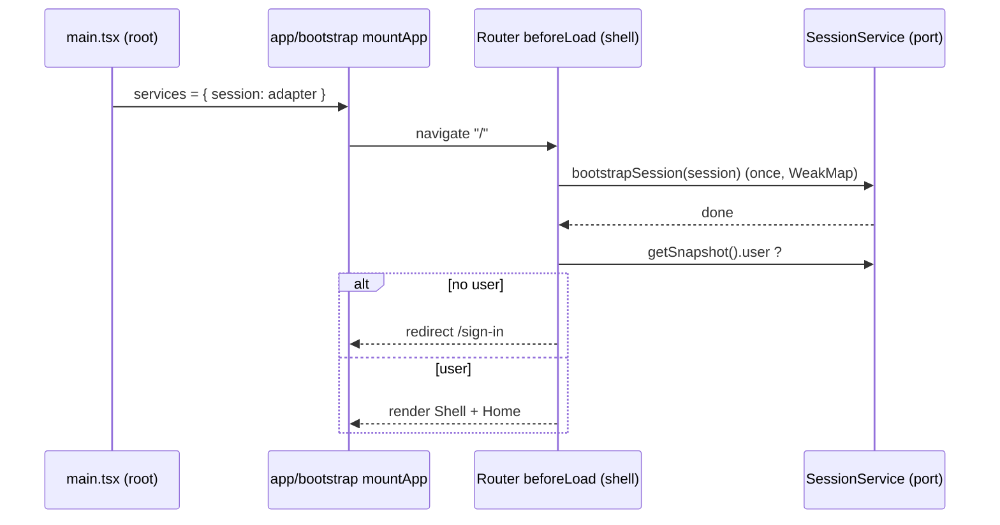
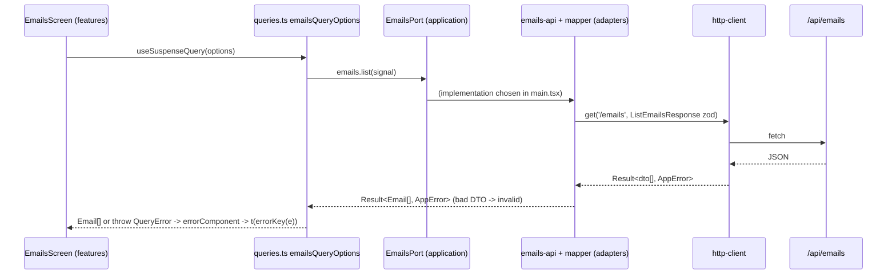
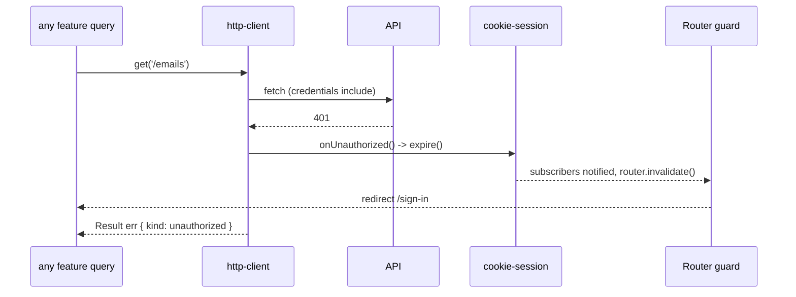
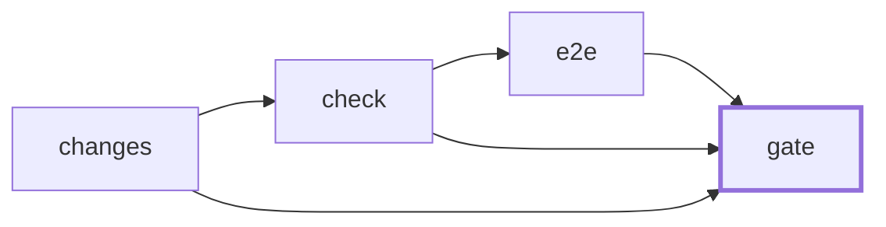

# web-react overnight bootstrap run (2026-10-20)

Started 01:47 (UTC+7). Goal: finish bootstrap-plan steps 5-14, plus the two pending items. Draft only: no commits, no push.

## Summary
| Step | Builder | Status | Checks | Coverage |
|---|---|---|---|---|
| Pending: 408/429 -> network, pretest/prebuild generate | Claude r7 | done (awaiting review) | green | 100% lines, 94.9% branches |
| 5 DI and state | Claude r7 | done | green | 100% lines, 94.9% branches |
| 6 Routing and session | Claude r7 | done | green | 100% lines, 94.9% branches |
| 7 Cross-cutting | Claude r8 | done | green | 99.4% lines, 95.7% branches |
| 8 Sample feature | Claude r8 | done | green | 99.4% lines, 95.7% branches |
| 9 Quality | Claude r9 | done | green + e2e 1/1 | 99.5% lines, 98.3% branches |
| 10 Security baseline | Claude r9 | done | green | 99.5% lines, 98.3% branches |
| 11 .okf content | Claude r10 | done | green, okf 57 concepts | n/a |
| 12 CI | Claude r10 (+ r11 fix) | done | YAML parsed, hook sh -n ok, not run on GitHub | n/a |
| 13 Docs | Claude r10 | done | green | n/a |
| 14 Deploy | Claude r11 + Codex r12 (verify) | done | green, docker not built | 99.6% lines |

## Rounds

### Round r7 (Claude): pending items + steps 5, 6
Prompt: /tmp/wr-r7.txt. Log: /tmp/wr-r7.out. Duration 01:48-01:54.

#### Builder raw report
```
Part A and Part B (steps 5 and 6) are done. `pnpm check` is green end to end (format, lint, typecheck, 82 tests with coverage, build, okf), and `python3 .okf/tools/okf.py --check` passes with 28 concepts. Steps 5 and 6 are marked done in the bootstrap plan, with log lines.

**Files changed**
- `src/adapters/api/http-client.ts` + test: 408 and 429 map to `network`, one test each.
- `.okf/adr/0012-result-and-app-error.md`, `.okf/backlog/bootstrap-plan.md`: updated mapping, noted as decided by orchestrator, awaiting owner review.
- `package.json`: added `prebuild` and `pretest` (both run `pnpm generate`), plus exact pins `@tanstack/react-query` 5.104.5 and `@tanstack/react-router` 1.170.45.
- `src/app/query-client.ts` + test: ADR 0013 retry and refetch defaults.
- `src/app/session-bootstrap.ts` + test: bootstrap runs at most once per service; a failed start is forgotten.
- `src/app/router.tsx`: code-based router, typed context, `beforeLoad` guard, root `notFound`, `errorComponent` on root and shell.
- `src/app/route-components.tsx`: root error, not-found, sign-in placeholder and shell components.
- `src/app/App.tsx`: providers; `App` re-runs the guards when the session changes.
- `src/app/bootstrap.tsx` + test: `mountApp(services)`, shared by both entry files.
- `src/main.tsx`, `src/main.mock.tsx`: composition roots. The mock one is a skeleton.
- `src/adapters/auth/in-memory-session.ts` + test: placeholder session adapter.
- `src/app/App.test.tsx`, `src/app/services/use-session.test.tsx`: rewritten around the shared test helpers.
- `src/test/render-with-providers.tsx`, `src/test/fakes/{session,services}.ts`, `src/test/setup.ts`: test harness, fakes, 3 s async timeout, jsdom `scrollTo` stub.
- `eslint.boundaries.config.js`: policy so `src/test/` can only be imported by tests. 14 new fixtures (app/services, adapters/auth, `main.mock.tsx`, test helpers).
- `eslint.config.js`: `only-throw-error` allows the router's `Redirect`.
- `vitest.config.ts`: `main.mock.tsx` excluded from coverage.
- `.okf/log.md`, `adr/0016`, `adr/0017`, `engineering/constraints.md`, `architecture/components/overview.md`: docs-sync.

**Checks and coverage**
- Lines 100%, statements 100%, functions 100%, branches 94.87%. The 80% gate passes.
- TanStack Query and Router install and typecheck on ESLint 10.13 and TypeScript 6.0.3.
- `pnpm peers check` still warns that `eslint-plugin-import` (pulled in by boundaries) wants ESLint 9 or lower. I didn't touch it.

**Deviations and caveats**
- `check` generates twice, because `build` now triggers `prebuild` after the explicit `generate` at the start. I accepted this: the first run is needed before lint and typecheck.
- `test:coverage` has no `pre` script, so on a fresh clone it still needs `pnpm generate` first.
- `RouterProvider`'s `context` prop does not re-run guards, so `App` subscribes to the session and calls `router.invalidate()`.
- `reset()` alone does not retry a failed `beforeLoad`, so the "Try again" button also invalidates.
- The `session` in router context is kept per ADR 0013 but is not what the guard reads (see decision 2).

**Decisions taken** (decided by builder, awaiting owner review; all in `.okf/log.md`)
1. Routes are code-based, with no file-based generator.
2. The guard reads `services.session.getSnapshot()` after the bootstrap, because `context.session` is stale on first load.
3. Bootstrap memoisation lives in one `WeakMap` helper in `app/`, not in each adapter.
4. `main.tsx` uses a signed-out in-memory session, so the real build only shows the sign-in placeholder until step 10. `main.mock.tsx` uses a demo user.
5. Test helpers in `src/test/` are importable only by tests and by each other. Production code cannot import them.
6. Mock-mode entry selection stays open until step 9, and `index.html` does not reference `main.mock.tsx`.
7. Strings are placeholder English until step 7, and the sign-in `redirect` search param is omitted.
8. `renderWithProviders(ui, { services, path })` replaces whole ports. `renderApp` renders the real route tree. Fakes take partial overrides.

No "factory" skill was listed, so I worked without one. No commits or pushes were made, and no AI markers or external repo names were added.
```

#### Orchestrator review
- Re-ran `pnpm check` myself: exit 0. 82 tests, coverage statements 100% / branches 94.87% / functions 100% / lines 100%. `okf.py --check`: ok, 28 concepts.
- `http-client.ts`: 408/429 checked before the generic 4xx branch, so they become `network` with status; everything else unchanged. Never throws. Conforms to ADR 0012 as amended.
- `query-client.ts`: retries only non-deterministic failures (`network` and unknown errors), max 2; `refused`/`unauthorized`/`invalid` never retry; mutations never retry. Conforms to ADR 0013.
- `router.tsx`: guard in `beforeLoad` (not in an effect), bootstrap memoised per service via `WeakMap`, failed bootstrap forgotten so the next navigation retries. Good.
- Scope: no store added, no repo names, no commits. Test helpers in `src/test/` are lint-blocked from production code (good, prevents fakes leaking into the bundle).
- Minor, not blocking: `RouterContext.session` is kept but stale (guard reads the service). Either drop it from the context or refresh it on invalidate. Logged for step 10 review.
- Minor: `pnpm check` runs `generate` twice (explicit + `prebuild`). ~1 s cost, accepted.
- Untested branches: `http-client.ts` lines 26 (error body not JSON) and 53 (`signal` passed). Left; covered >80%.

#### Decisions needing Huy's approval
| # | Decision | Alternative |
|---|---|---|
| D1 (orchestrator) | 408 and 429 map to `network` (retryable) | keep `refused` per original ADR 0012 |
| D2 (orchestrator) | `pretest`/`prebuild` run `pnpm generate`; `check` generates twice | a single `generate` and a `pre` hook only on `test:coverage` |
| D3 | Code-based routes, no file-based route generator | `@tanstack/router-plugin` file routes |
| D4 | Guard reads `services.session.getSnapshot()` after bootstrap | keep `context.session` and refresh the context on every session change |
| D5 | Bootstrap memoisation in one `WeakMap` helper in `app/` | each session adapter makes its own `bootstrap()` idempotent |
| D6 | Production `main.tsx` uses a signed-out in-memory session until step 10 | block the production build until the real adapter exists |
| D7 | `src/test/` importable only by tests | allow `main.mock.tsx` to reuse fakes |
| D8 | `renderWithProviders(ui, { services, path })` replaces whole ports; fakes take partial overrides | per-method spies |

#### Explain
What changed: the app now has one place that builds dependencies (`main.tsx` / `main.mock.tsx`), hands them to React via `ServicesContext`, and a router whose context carries `queryClient`, `services`, `session`. The shell route's `beforeLoad` makes sure the session has been loaded once and redirects to `/sign-in` when there is no user.
Why: ADR 0010 (composition roots pick implementations; features only see ports through `useServices()`), ADR 0013 (TanStack Query defaults, guards in `beforeLoad`), ADR 0014 (session port with an idempotent bootstrap).
Where the rules live: `src/app/query-client.ts` (retry rule), `src/app/session-bootstrap.ts` (once-only start), `src/app/router.tsx` (guard), `eslint.boundaries.config.js` (who may import `app/services` and `src/test`).



#### Understanding check
1. Why does a 429 retry but a 403 never does? Which file decides that?
2. If two tabs of StrictMode effects call the guard at the same time, how many times does `session.bootstrap()` run, and what happens if it fails?
3. Why can't `src/features/home` import `src/test/fakes/session.ts`?

### Round r8 (Claude): steps 7, 8
Prompt: /tmp/wr-r8.txt. Log: /tmp/wr-r8.out. Duration 01:55-02:04.

#### Builder raw report
```
Steps 7 and 8 are built. `pnpm check` and `python3 .okf/tools/okf.py --check` both pass. Both steps are marked done in the plan, with log lines. Nothing is committed or pushed. The factory skill set wasn't available, so I worked directly.

**Checks:** 21 test files, 126 tests. Coverage is 99.38% lines, 98.87% statements and 95.65% branches, against the 80% gate.

**Lint plugins and ESLint 10 (pinned at 10.13, not pinned back):**
- `@tanstack/eslint-plugin-query` 5.104.4 supports ESLint 10 (peer `^10`) and is on.
- `@vitest/eslint-plugin` 1.6.27 works on ESLint 10 (peer `>=8.57`) and is on, for `*.test.*` files.
- `eslint-plugin-jsx-a11y` 6.10.2 only lists ESLint up to 9. I dropped it per plan decision 15 and added `backlog/jsx-a11y-eslint-10.md`.

**Files changed:**
- **Step 7, i18n:** `locales/en.json`, `app/i18n.ts`, `application/error-key.ts`. `route-components.tsx` and `home-screen.tsx` now use keys.
- **Step 7, design system and theme:** `ds/tokens.css`, `ds/layout.tsx` and `layout.module.css` (Page, Stack, Inline), `app/theme.ts`.
- **Step 7, error handling and wiring:** `app/error-reporting.ts`, `adapters/telemetry/logger-crash-reporter.ts`, `application/services.ts` (adds `logger` and `crashReporter`), `app/App.tsx`, `app/bootstrap.tsx`.
- **Step 8, domain and adapters:** `domain/email.ts`, `application/emails.ts`, `adapters/api/email-mapper.ts`, `adapters/api/emails-api.ts`.
- **Step 8, feature and wiring:** `features/emails/` (`queries.ts`, screen, layout CSS), the `/emails` route and nav link in `app/router.tsx`, `main.tsx`, `main.mock.tsx` (MSW worker with demo emails), `public-mock/mockServiceWorker.js`.
- **Tests:** a unit test beside each new unit, `src/test/fakes/` (emails, logger, services), `render-with-providers.tsx`, `bootstrap.test.tsx`.
- **Boundaries:** `eslint.boundaries.config.js` now bans non-React framework imports from `ds/`. `boundaries.test.ts` is split into violation and ok cases. There are 11 new fixtures (5 violation, 6 valid).
- **Config and deps:** `eslint.config.js`, `.prettierignore`, `package.json` and lockfile (i18next, react-i18next, the two plugins, the TypeScript import resolver; the alias resolver is removed).
- **`.okf`:** bootstrap-plan, log, ADRs 0013, 0015 and 0016, constraints, components overview, map, backlog index.

**Deviations from the plan or ADRs:**
- I swapped `eslint-import-resolver-alias` for `eslint-import-resolver-typescript`. The alias resolver throws on `msw/browser`, which has `node: null` in its `exports`.
- `ds/` was documented as React-only but nothing enforced it, so I added the ban.
- The route loader uses `queryClient.query({ ...options, staleTime: 'static' })` instead of `ensureQueryData`, which is deprecated and fails lint.
- `errorKey` returns `errors.<kind>` only. JSON can't hold both `errors.<kind>` and `errors.<kind>.<code>`, and the contract has no codes.
- Mock mode can't be launched yet: `main.mock.tsx` and `public-mock/` exist, but nothing loads them until step 9 wires the mode, the entry and `publicDir`. The Emails screen is covered by component tests with a fake port. The adapter is covered by MSW node tests.

**Decisions taken** (all in `.okf/log.md` as "decided by builder, awaiting owner review"):
- `EmailsPort` has `list` only; `getEmail` stays in the contract until there is a detail screen.
- `createEmail` returns a `Result`, and the mapper turns an `Err` into `invalid`.
- The theme follows the OS preference, with no toggle or storage.
- The API base URL is the constant `/api` until runtime config in step 14.
- A logger-backed crash reporter stands in until a hosted service is chosen.
- `Page` renders the `main` landmark.

**Still needs your verification:**
- The mock service worker file is a copied, version-coupled MSW script.
- Route error components report each error in an effect, so StrictMode in dev may report twice.
- Step 9 must keep `public-mock/` and `main.mock.tsx` out of the production bundle.
```

#### Orchestrator review
- Re-ran `pnpm check`: exit 0, 21 files / 126 tests, statements 98.87%, branches 95.65%, functions 98.55%, lines 99.38%. `okf.py --check`: ok, 29 concepts.
- **Resolver swap re-verified.** Your earlier rule was "avoid the TypeScript resolver because it breaks `pnpm install --frozen-lockfile`". I copied the repo (no `node_modules`) to `/tmp/wr-frozen` and ran `CI=true pnpm install --frozen-lockfile` then `pnpm lint`: both exit 0. It works now because `allowBuilds: unrs-resolver: false` (step 3/4) stops the postinstall that used to fail. Still a reversal of your rule, so it is D9 below.
- **Supply-chain note (from r7, not reported by the builder):** `pnpm-workspace.yaml` has `minimumReleaseAgeExclude` for `@tanstack/query-core@5.104.5` and `@tanstack/react-query@5.104.5`, i.e. pnpm's "don't install packages younger than N days" protection is bypassed for those two exact versions. Not recorded in any ADR. D10 below.
- `features/emails/queries.ts`: the only `Result` unwrap; throws `QueryError` (ADR 0012 exception). Shared `queryOptions` for loader and screen (ADR 0013). Good.
- `adapters/api/emails-api.ts` + `email-mapper.ts`: generated zod at the boundary, domain constructor rejects bad DTOs as `invalid`. No repository / use-case layer (as planned).
- `app/error-reporting.ts`: global `error` + `unhandledrejection` go to `CrashReporter`; returns an uninstall function (testable).
- `ds/` now lint-banned from importing non-React frameworks: scope creep but small and it enforces ADR 0011 text. Accepted.
- No `localStorage`, no `dangerouslySetInnerHTML` in `src/` (grep).
- Open for step 9: mock mode not runnable yet; `public-mock/mockServiceWorker.js` is a copied, version-coupled MSW file.

#### Decisions needing Huy's approval
| # | Decision | Alternative |
|---|---|---|
| D9 | `eslint-import-resolver-typescript` replaces the alias resolver (alias resolver crashes on `msw/browser` exports); frozen install verified green | keep alias resolver and add a manual alias for `msw/browser` |
| D10 | `minimumReleaseAgeExclude` for TanStack Query 5.104.5 (added in r7) | pin the previous TanStack version that is old enough and drop the exclusion |
| D11 | `jsx-a11y` dropped (peer ESLint <=9), backlog `jsx-a11y-eslint-10.md` | install with `--force` peer override |
| D12 | `errorKey` returns `errors.<kind>` only (no per-code keys) | nested `errors.<kind>.default` + `errors.<kind>.<code>` |
| D13 | Loader uses `queryClient.query({ ...options, staleTime: 'static' })` (`ensureQueryData` deprecated) | `prefetchQuery` |
| D14 | `EmailsPort` has `list` only | add `get` now |
| D15 | Theme follows OS preference, no toggle/storage | toggle persisted in a cookie |
| D16 | Logger-backed `CrashReporter` until a hosted service is chosen | pick a hosted service now |
| D17 | API base URL is constant `/api` until step 14 | `VITE_API_URL` now |

#### Explain
What changed: strings now come from `src/locales/en.json` through i18next, and `TranslationKey` is derived from that file so a wrong key is a type error. `AppError` gets turned into a key by one function (`errorKey`). The design system is CSS variables in `ds/tokens.css` with `[data-theme]` light/dark and three layout primitives. Uncaught errors go to `CrashReporter`. The Emails slice is the first real feature.
Why: ADR 0015 (keys from `en.json`), ADR 0011 (CSS variables + CSS Modules, no Tailwind), ADR 0012 (adapters return `Result`, `queries.ts` throws `QueryError` for TanStack Query), ADR 0010 (feature reads ports via `useServices()`).
Where the rules live: `src/application/error-key.ts`, `src/app/i18n.ts`, `src/ds/tokens.css`, `src/app/error-reporting.ts`, `src/features/emails/queries.ts`, `eslint.boundaries.config.js`.



#### Understanding check
1. A server returns an email with a bad `receivedAt`. Which layer rejects it, and what `AppError.kind` does the screen show?
2. Why is `queries.ts` allowed to throw when the rule says adapters never throw?
3. If you add `"errors.refused.quota"` to `en.json`, what breaks and why did the builder avoid per-code keys?

### Round r9 (Claude): steps 9, 10
Prompt: /tmp/wr-r9.txt. Log: /tmp/wr-r9.out. Duration 02:06-02:16.

#### Builder raw report
```
Steps 9 and 10 are done and marked in `bootstrap-plan.md` with log lines. `pnpm check`, `pnpm e2e` and `python3 .okf/tools/okf.py --check` all pass, and nothing is committed or pushed. No factory skill is installed, so I worked directly from the plan and ADRs.

**Files changed**
- **Mock mode, e2e and tooling:**
  - `vite.config.ts`, `vitest.config.ts`
  - `package.json`, `pnpm-lock.yaml`
  - `.gitignore`, `.prettierignore`, `tsconfig.json`
  - `playwright.config.ts`, `e2e/smoke.spec.ts`
  - `scripts/check-bundle.mjs`, `scripts/secret-scan.mjs` (each with a test)
- **Security client:**
  - `openapi/emails.yaml` (adds `GET` and `DELETE /session`)
  - `adapters/api/http-client.ts`, `adapters/api/csrf.ts`
  - `adapters/auth/cookie-session.ts`, `adapters/auth/in-memory-session.ts`
  - `adapters/telemetry/redact.ts`, `adapters/telemetry/console-logger.ts`
  - `application/session.ts` (adds `expire()`), `main.tsx`
- **Router context:** `app/App.tsx`, `app/router.tsx` and `test/render-with-providers.tsx` (`session` dropped).
- **Lint:** `eslint.config.js` and the new `eslint.security.config.js`.
- **Tests:** new tests for each of the above, plus `app/session-expiry.test.tsx` (real client and cookie session, 401 redirects to sign-in), `src/test/security-lint.test.ts` and 5 boundary fixtures for the new edges.
- **`.okf`:** new ADR 0019. Synced ADRs 0007, 0013, 0014, 0016, 0017 and 0018, plus constraints (K17, K24, new K31-K35), the components overview, containers, index, map, the plan and the log.

**Results**
- **`pnpm check`:** green, now including `check:bundle` and `scan:secrets`.
- **Coverage:** 99.53% lines (99.18% statements).
- **`pnpm e2e`:** green. 1 chromium smoke test against `vite preview --mode mock`.
- **Bundle check:** `dist/` is clean of msw, `mockServiceWorker`, `main.mock` and source maps. `--expect-mock dist-mock` confirms the mock build does contain them, so the check can't pass on an empty scan.
- **`okf.py --check`:** ok, 30 concepts.

**Deviations**
- I did not write new model, mapper, adapter, `queries.ts` or component tests for step 9. Step 8 already had them.
- `minimumReleaseAgeExclude` for TanStack Query 5.104.5 stays. The pair was about 2 hours old by the system clock, and the sandbox blocked a clean-resolution experiment. ADR 0016 records the reason and the removal condition. I could not verify pnpm's default age window.
- The secret scan flagged a sample JWT in my own redaction test. I built the sample from parts rather than exempting the file.

**Decisions (decided by builder, awaiting owner review, all in `.okf/log.md`)**
- e2e is its own script, not part of `pnpm check`, per plan decision 7 and ADR 0018. The bundle check is in `check`.
- A Vite `transformIndexHtml` plugin (`order: 'pre'`) swaps the entry to `main.mock.tsx`. Mock mode builds to `dist-mock/` and uses `public-mock/`.
- `RouterContext.session` is dropped, not kept fresh.
- `bootstrap()` treats 401 as signed out and throws on any other failure. `signOut()` throws and keeps the user if the API didn't sign out.
- CSRF defaults to cookie `XSRF-TOKEN` and header `X-XSRF-TOKEN`. The `/session` paths are guesses until the real API exists.
- No HTML sanitizer, since nothing renders HTML. A lint ban on `dangerouslySetInnerHTML` forces the decision when something does.
- The secret scan is pattern-based over git-known files and `dist/`, with no history scan.

**AI assumptions that need human verification**
- The CSRF names and `/session` contract.
- That the redaction key list (including `session` as a substring) is not too broad.
- ADR 0019 wording.
```

#### Orchestrator review
- Re-ran `pnpm check`: exit 0, 28 files / 178 tests, statements 99.18%, branches 98.3%, functions 98.9%, lines 99.53%; `check:bundle` and `scan:secrets` (203 files) pass. Re-ran `pnpm e2e`: 1 chromium smoke passed (1.2 s). `okf.py --check`: ok, 30 concepts.
- Single 401 handler: `http-client.ts` calls `onUnauthorized` once per 401; `main.tsx` wires it to `session.expire()`; `expire` is a no-op when already signed out, so a 401 storm does not re-render repeatedly. Tested end to end in `app/session-expiry.test.tsx`. Conforms to ADR 0014.
- CSRF: header copied from a readable `XSRF-TOKEN` cookie onto non-GET requests only; the session cookie itself stays httpOnly and is never read by JS. `credentials: 'include'` on every call. Conforms to ADR 0009 (API owns issuing/validation).
- `cookie-session.ts` stores only the user object the API returns; no storage writes. Bootstrap: 401 = signed out, other failures throw (error boundary + retry on next navigation). Good.
- `redact.ts`: masks sensitive keys and Bearer/JWT strings, depth-limited, never mutates. The `session` substring rule may also mask harmless keys such as `sessionStartedAt`; acceptable over-redaction.
- Bundle check is two-sided (prod must not contain mock code, mock must contain it), so an empty scan cannot pass. Good design.
- `minimumReleaseAgeExclude` kept; now documented in ADR 0016 with a removal condition. Still D10.
- Not done by design: no HTML sanitizer (nothing renders HTML; lint ban on `dangerouslySetInnerHTML` forces the decision later).

#### Decisions needing Huy's approval
| # | Decision | Alternative |
|---|---|---|
| D18 | e2e is its own script (`pnpm e2e`), not inside `pnpm check`; bundle check is inside `check` | run e2e inside `check` (slower local loop) |
| D19 | Vite `transformIndexHtml` plugin swaps the entry to `main.mock.tsx` in mock mode; mock builds to `dist-mock/` with `public-mock/` | a second `index.mock.html` |
| D20 | `RouterContext.session` dropped | keep it and refresh on every session change |
| D21 | CSRF names `XSRF-TOKEN` / `X-XSRF-TOKEN`; `/session` GET/DELETE contract added to `openapi/emails.yaml` (guessed until the real API) | wait for the .NET spec |
| D22 | No sanitizer until something renders HTML; lint ban on `dangerouslySetInnerHTML` | add DOMPurify now |
| D23 | Secret scan is pattern-based over git-known files and `dist/`, no history scan | add gitleaks in CI |
| D24 | ADR 0019 "client-side security baseline" wording | — (read the ADR) |

#### Explain
What changed: the real session adapter talks to `/session` with the browser's cookie; the HTTP client adds CSRF headers and is the only place that notices a 401. Logs are redacted. Mock mode is a separate build that a Playwright test drives, and a script proves mock code never ships in the real `dist/`.
Why: ADR 0009 (API owns cookies/CSRF), ADR 0014 (single 401 handler), ADR 0019 (S1-S7 on the web), ADR 0017/0018 (test tiers, mock build for e2e), constraint K24 (no mock code in production).
Where the rules live: `src/adapters/api/http-client.ts` (401, CSRF, credentials), `src/adapters/auth/cookie-session.ts`, `src/adapters/telemetry/redact.ts`, `eslint.security.config.js` (storage and `dangerouslySetInnerHTML` bans), `scripts/check-bundle.mjs`, `scripts/secret-scan.mjs`.



#### Understanding check
1. Why can JS read `XSRF-TOKEN` but must never read the session cookie? What attack does each defend against?
2. Where is the one line that turns any 401 into "signed out"? What happens if two requests get 401 at once?
3. How does `check-bundle.mjs` avoid passing when it scans nothing?

### Round r10 (Claude): steps 11, 12, 13
Prompt: /tmp/wr-r10.txt. Log: /tmp/wr-r10.out. Duration 02:17-02:25. Ran with `--add-dir ..` (needed for `.githooks/` and root `README.md`); prompt limited outside writes to 4 named files, verified with `git status` at the repo root: only those 4 changed, `flutter/` untouched.

#### Builder raw report
```
Steps 11, 12 and 13 are done. `pnpm check`, `pnpm e2e` (1 test passed) and `okf.py --check` (57 concepts, 69 files) are green. Nothing is committed or pushed, and I added no AI markers. No factory skill set was listed, so I worked without one.

**Files changed**
- **`web-react/.okf/`:**
  - Seven layer pages under `architecture/components/` (L3 plus L4 key types) and the Emails request sequence.
  - Two engineering conventions (`lint-rules`, `test-harness`) and four workflows (add a feature, build and test, run the app, run e2e).
  - Ten glossary terms and three `domains/emails` pages.
  - Updated: indexes, the overview (the "Real today" list now links to the layer pages), constraints (K25/K26 sync), ADR 0018 (a "Built in step 12" section), `bootstrap-plan.md` (steps 11–13 marked done) and `log.md`. `map.md` was regenerated.
- **Outside `web-react/`:** `.github/workflows/web-react.yml`, `.github/dependabot.yml`, `.githooks/pre-commit`, and the web-react rows in `README.md`.
- **Docs:** `web-react/README.md` (quick start, scripts, mock mode, layout, add a feature, CI).

**Checks**
- **`pnpm check`:** green end to end; line coverage is 99.5% against the 80% gate.
- **Workflow and Dependabot YAML:** parsed with Python `yaml`; the workflow has jobs changes, check, e2e, gate, and Dependabot has pub, npm, github-actions.
- **Not run:** `sh -n` on the pre-commit hook was blocked by the permission prompt, so its syntax and behaviour are unchecked. The workflow has not run on GitHub either.

**CI job graph**
`changes` → `check` (audit, `pnpm check`) → `e2e` → `gate` (`gate` needs all three).
- **`changes`:** now also outputs `e2e`, true only on a pull request to `main` with `web-react/` changes.
- **`e2e`:** installs dependencies, caches `~/.cache/ms-playwright` under `playwright-<os>-<version>`, runs `pnpm e2e`, and uploads traces on failure.
- **`gate`:** requires e2e to be `success` when it is required, and accepts `skipped` otherwise. It stays the only required check.

**Deviations**
- Pre-commit failing when `web-react/node_modules` is missing is my addition.
- ADR 0018 still says "reusable workflow (`workflow_call`)" in its Decision section. The workflow has none, by the earlier step 2 choice. I added a built-notes section instead of rewriting the accepted decision.
- The root README still names an external reference repo in its "Design reference" line. That is outside the web-react section, so I left it. You may want it removed.

**Decisions taken (all in `.okf/log.md` as "decided by builder, awaiting owner review")**
1. `e2e` runs after `check` instead of in parallel. Green runs are slower, but a failing check skips the browser download.
2. e2e is required on pull requests to `main` only. Merge-queue and push runs skip it.
3. Dependabot ignores major TypeScript bumps while ADR 0006 pins 6.0.3, and it groups dev minor/patch updates.
4. The pre-commit hook runs Prettier on staged `web-react/` files and refuses partially staged ones, like the Dart gate.
5. New `.okf` pages are `status: draft`.
6. The Emails sequence is a page under `architecture/components/`, and I added no new `architecture/` subfolders.
7. Playwright system dependencies are installed on every run (`install-deps` on a cache hit), because only the browser directory is cached.

Please check the step-12 YAML and hook before pushing, since CI behaviour only shows on GitHub.
```

#### Orchestrator review
- Re-ran `pnpm check`: exit 0. `okf.py --check`: ok, 57 concepts / 69 files. `sh -n .githooks/pre-commit` (the builder could not run it): syntax OK.
- Outside `web-react/`: only `.githooks/pre-commit`, `.github/dependabot.yml`, `.github/workflows/web-react.yml`, root `README.md` (2 table rows) changed. `flutter/` untouched.
- Workflow: `changes -> check -> e2e -> gate`; `gate` is `if: always()` and the only required check; e2e required only on PRs to `main`. Matches ADR 0018 and plan decision 7.
- **Finding (fixed in r11):** `web-react.yml` used tag refs (`actions/checkout@v4`, `setup-node@v4`, `cache@v4`, `upload-artifact@v4`) while the flutter workflow pins by commit SHA and `dependabot.yml` says "the workflow pins actions by commit SHA". I looked up current release SHAs with `git ls-remote` and passed them to r11.
- **Finding (fixed in r11):** ADR 0018 Decision text still says "reusable workflow (`workflow_call`)" although step 2 chose no `workflow_call`.
- **Finding (needs Huy):** root `README.md` line 17 "Design reference" names an external repo. It is pre-existing and committed, outside the web-react section, so I did not change it. Your rule says no external repo names in files; decide whether to remove it.
- Pre-commit hook: runs only when `web-react/` files are staged (flutter-only commits pay nothing), refuses partially staged files, fails if `node_modules` is missing (builder addition, D29).
- No external-repo names and no AI markers in `web-react/`, `.github/`, `.githooks/` (grep).

#### Decisions needing Huy's approval
| # | Decision | Alternative |
|---|---|---|
| D25 | `e2e` runs after `check` (serial) | run in parallel for faster green runs |
| D26 | e2e required on PRs to `main` only; push and merge-queue skip it | also run in the merge queue |
| D27 | Dependabot ignores TypeScript majors (ADR 0006 pin) and groups dev/prod minor+patch | no grouping |
| D28 | Pre-commit runs Prettier on staged `web-react/` files and refuses partially staged ones | format only, no refusal |
| D29 | Pre-commit fails when `web-react/node_modules` is missing | skip silently |
| D30 | New `.okf` pages are `status: draft` | mark them accepted |
| D31 | `install-deps` runs every e2e job (only browsers are cached) | container image with deps |

#### Explain
What changed: the knowledge base now describes every layer as it exists (L3 pages, L4 key types, an Emails sequence), plus conventions, workflows and glossary. CI gained a browser job, Dependabot watches `web-react/`, the pre-commit hook formats web files. READMEs explain how to run and extend the stack.
Why: plan steps 11-13, ADR 0018 (one always-run `gate`), ADR 0007/0017 (e2e tier), ADR 0006 (TS pin respected by Dependabot).
Where the rules live: `.github/workflows/web-react.yml` (`gate` job script), `.github/dependabot.yml`, `.githooks/pre-commit`, `web-react/.okf/architecture/components/*.md`, `web-react/README.md`.



#### Understanding check
1. A PR only changes `flutter/`. Which web-react jobs run, and why does `gate` still pass?
2. Why does the gate accept `skipped` for `e2e` on a push to `main` but not on a PR to `main`?
3. Why are actions pinned by commit SHA instead of `@v4`?

### Round r12 (Codex): step 14 verify and finish
Prompt: /tmp/wr-r12.txt. Log: /tmp/wr-r12.out. Duration 13:53-14:00 (UTC+7). `codex exec --full-auto` is rejected by codex-cli 0.154.0 (and the ChatGPT app build 0.162.0-alpha has no such flag either), so the run used the equivalent `-s workspace-write`.
Note: step 14 itself was already built in r11 (Claude) and `bootstrap-plan.md` was deleted then, as the plan required; the summary row had not been updated. r12 verified it against ADR 0018 and closed gaps.

#### Builder raw report
```
codex
Step 14 verified and complete.

Files changed:

- Deploy tests: `docker/entrypoint.test.mjs`
- Architecture docs: `[.okf/architecture/containers.md](/Users/huy.nguyenquang/Documents/clean-architecture/web-react/.okf/architecture/containers.md)` (`.okf`)
  - Corrected CSRF wording to non-GET requests.
  - Added cache-policy and `/healthz` assertions.

Decisions:

- Existing `.okf/log.md` already records step-14 choices as “decided by builder, awaiting owner review”; no log change needed.
- Bootstrap plan is absent as required.
- No stale step-10 wording remains.

Checks:

- `pnpm check`: passed
- 31 test files, 231 tests passed
- Coverage: 99.6% lines
- `python3 .okf/tools/okf.py --check`: passed

Docker:

- Docker CLI exists, but daemon access failed; image build and curl checks were skipped. No daemon started.

Remaining:

- Docker runtime, generated nginx headers, and browser CSP remain unverified in this environment.
- Existing sign-in redirect placeholder remains unrelated to step 14.
diff --git a/web-react/.okf/architecture/containers.md b/web-react/.okf/architecture/containers.md
index 3b2442578b9e0cf84be9066e9cf7010bcd29c7a2..1ee6ce3399a3542aa097e9e878e028a0df0ecfc7
--- a/web-react/.okf/architecture/containers.md
+++ b/web-react/.okf/architecture/containers.md
@@ -10,7 +10,7 @@
 
 | Container | Technology | Role | In this repo |
 |---|---|---|---|
-| **Web SPA** | Vite build, React 19, TypeScript; static files served by the hosting container below | Runs in the browser; talks HTTPS/JSON to the API. Sends `credentials: 'include'` and the CSRF header on every API call | Yes, `web-react/` |
+| **Web SPA** | Vite build, React 19, TypeScript; static files served by the hosting container below | Runs in the browser; talks HTTPS/JSON to the API. Sends `credentials: 'include'` and the CSRF header on non-GET API calls | Yes, `web-react/` |
 | **Web hosting** | `nginx-unprivileged` container built from `web-react/Dockerfile` | Serves the built SPA as non-root on port 8080. At start the entrypoint writes `/env.js` and the nginx config (CSP with `connect-src` from `API_URL`, security headers); TLS is terminated by the platform in front ([ADR 0018](../adr/0018-ci-and-runtime-delivery.md)) | Yes, `web-react/Dockerfile` |
 | **.NET API** | ASP.NET | Business data, sessions and CSRF validation ([ADR 0009](../adr/0009-cookie-session-and-csrf-owned-by-the-api.md)); validates sign-in results from the identity provider | No |
 | **Identity provider** | Chosen per project | Authenticates the end user in the browser | No |
diff --git a/web-react/docker/entrypoint.test.mjs b/web-react/docker/entrypoint.test.mjs
index 77e6f734b07c74a24ee2609d12ae8b4b3e2f1e20..da192b1c1808984f64d4ef4146d4d4b483eab178
--- a/web-react/docker/entrypoint.test.mjs
+++ b/web-react/docker/entrypoint.test.mjs
@@ -120,6 +120,17 @@
     expect(conf).toContain('root /srv/www;');
     expect(conf).toContain('server_tokens off;');
   });
+
+  it('sets the required cache policy and health endpoint', () => {
+    const { conf } = run({ API_URL: 'https://api.example.com' });
+
+    expect(conf).toContain('add_header Cache-Control "no-store" always;');
+    expect(conf).toContain('add_header Cache-Control "public, max-age=31536000, immutable" always;');
+    expect(conf).toContain('try_files $uri /index.html;');
+    expect(conf).toContain('add_header Cache-Control "no-cache" always;');
+    expect(conf).toContain('location = /healthz {');
+    expect(conf).toContain('return 200 "ok\\n";');
+  });
 });
 
 describe('entrypoint validation (same rule as the zod parser)', () => {

hook: Stop
hook: Stop Completed
tokens used
119,203
Step 14 verified and complete.

Files changed:

- Deploy tests: `docker/entrypoint.test.mjs`
- Architecture docs: `[.okf/architecture/containers.md](/Users/huy.nguyenquang/Documents/clean-architecture/web-react/.okf/architecture/containers.md)` (`.okf`)
  - Corrected CSRF wording to non-GET requests.
  - Added cache-policy and `/healthz` assertions.

Decisions:

- Existing `.okf/log.md` already records step-14 choices as “decided by builder, awaiting owner review”; no log change needed.
- Bootstrap plan is absent as required.
- No stale step-10 wording remains.

Checks:

- `pnpm check`: passed
- 31 test files, 231 tests passed
- Coverage: 99.6% lines
- `python3 .okf/tools/okf.py --check`: passed

Docker:

- Docker CLI exists, but daemon access failed; image build and curl checks were skipped. No daemon started.

Remaining:

- Docker runtime, generated nginx headers, and browser CSP remain unverified in this environment.
- Existing sign-in redirect placeholder remains unrelated to step 14.
```

#### Orchestrator review
- Re-ran `pnpm check` myself: exit 0. 231 tests, coverage statements 99.29% / branches 98.65% / functions 98.96% / lines 99.6%. Bundle check, secret scan (245 files), `okf.py --check` (56 concepts) ok.
- r12 changed 2 files only: `docker/entrypoint.test.mjs` (+ cache policy and `/healthz` test) and `.okf/architecture/containers.md` (CSRF wording: non-GET requests). **.okf change for review: containers.md.**
- Every ADR 0018 Deploy bullet maps to code + test: `/env.js` before the module (index.html), zod parse with one failure path (`runtime-config.ts`, `boot-error.ts`), nginx-unprivileged image, entrypoint writes env.js + CSP with `connect-src` from `API_URL`.
- Not verified (no Docker daemon access, none started): image build, real headers, uid 101 write to `/etc/nginx/conf.d`, CSP in a browser.

#### Explain
What changed: one image for all environments. At container start the entrypoint validates `API_URL`, writes `/env.js` and the CSP, then starts nginx. In the browser `main.tsx` parses `window.__ENV__` once; bad config shows a boot error page and the app never mounts.
Why: ADR 0018 (runtime config, no build-time env in prod), ADR 0019 S2/S5 (CSP, headers).
Where: `docker/entrypoint.sh`, `Dockerfile`, `src/app/runtime-config.ts`, `src/app/boot-error.ts`, `src/main.tsx`.

```mermaid
sequenceDiagram
  participant P as Platform (env API_URL)
  participant E as entrypoint.sh
  participant N as nginx
  participant B as Browser
  participant M as main.tsx
  P->>E: start container
  E->>E: validate API_URL (same rule as zod)
  alt invalid
    E-->>P: exit non-zero (never serves)
  else valid
    E->>N: write env.js, CSP headers, server conf; exec nginx
    B->>N: GET / , /env.js (no-store)
    B->>M: run module
    M->>M: zod parse window.__ENV__
    alt invalid
      M-->>B: renderBootError (no app)
    else ok
      M-->>B: mountApp(services with API_URL)
    end
  end
```

#### Understanding check
1. Why does the entrypoint repeat the zod rule in `sh`, and what keeps the two from drifting?
2. Why must every nginx `location` with its own `add_header` include the headers file again?
3. Where does `connect-src` get the API origin, and what breaks if the API URL changes but the image is not restarted?

## Flutter check (orchestrator, 2026-10-20 13:50 UTC+7)
Same steps as `.github/workflows/flutter-ci.yml`, run locally in `flutter/`:
| Step | Result |
|---|---|
| `okf.py --check` | ok, 126 concepts |
| `flutter pub get` / `build_runner build -d` | ok |
| `dart format --set-exit-if-changed` | 71 files, 0 changed |
| `flutter analyze` | no issues |
| `flutter test --coverage` | 62 passed |
| `check_coverage.dart 80` | 89.3% lines |
| `git status flutter/` | clean (nothing changed by the web work) |

Root files: `sh -n .githooks/pre-commit` ok. Hook run in a throwaway clone: staged Dart file gets formatted and re-staged (exit 0); staged `web-react/` file gets Prettier and re-staged (exit 0); partially staged web file refused (exit 1). `web-react.yml` filter regex on sample paths: `flutter/**`, `flutter-ci.yml`, `README.md`, `dependabot.yml` -> skip; `web-react/**`, `web-react.yml` -> run. `flutter-ci.yml` is unchanged (own `paths` filter). All three YAML files parse. Root README diff: only the 2 web-react table rows. Dependabot: `npm` + `docker` entries for `/web-react` added, `pub` entry unchanged. Nothing broken, nothing fixed.

## Triage of pending decisions (orchestrator, r12)
LOW = reversible, conventional, local: accepted as built, marked auto-applied (no code change needed, already in place). HIGH = left for Huy.
| Item | Priority | Action |
|---|---|---|
| D1 408/429 -> network (ADR 0012 amended) | HIGH | decided: accepted |
| D2 pretest/prebuild generate, check generates twice | LOW | auto-applied |
| D3 code-based routes | LOW | auto-applied |
| D4 guard reads session service | LOW | auto-applied |
| D5 WeakMap bootstrap memo | LOW | auto-applied |
| D6 in-memory signed-out session in prod until step 10 | LOW | obsolete (cookie session built in step 10) |
| D7 src/test only for tests | LOW | auto-applied |
| D8 renderWithProviders shape | LOW | auto-applied |
| D9 typescript import resolver | LOW | auto-applied |
| D10 minimumReleaseAgeExclude for TanStack | HIGH | decided: keep exclude, TODO in pnpm-workspace.yaml |
| D11 jsx-a11y dropped, backlog item | LOW | auto-applied (plan decision 15) |
| D12 errorKey per kind only | LOW | auto-applied |
| D13 loader query staleTime static | LOW | auto-applied |
| D14 EmailsPort list only | LOW | auto-applied |
| D15 theme follows OS, no toggle | HIGH | decided: accepted |
| D16 logger-backed CrashReporter | HIGH | decided: accepted |
| D17 constant /api | LOW | obsolete (replaced by API_URL in step 14) |
| D18 e2e outside pnpm check | LOW | auto-applied |
| D19 mock entry via transformIndexHtml, dist-mock | LOW | auto-applied |
| D20 RouterContext.session dropped | LOW | auto-applied |
| D21 CSRF names + guessed /session contract | HIGH | decided: template placeholder (comment in openapi, ADR 0019 note) |
| D22 no sanitizer yet, lint ban | HIGH | decided: accepted |
| D23 pattern secret scan, no history scan | HIGH | decided: gitleaks history scan added to CI |
| D24 ADR 0019 wording | HIGH | decided: accepted |
| D25 e2e serial after check | LOW | auto-applied |
| D26 e2e required only on PRs to main | HIGH | decided: accepted |
| D27 Dependabot TS-major ignore + groups | LOW | auto-applied |
| D28 pre-commit Prettier, refuse partial staging | LOW | auto-applied (tested) |
| D29 pre-commit fails without node_modules | LOW | auto-applied |
| D30 new .okf pages status draft | LOW | auto-applied |
| D31 install-deps every e2e run | LOW | auto-applied |
| S14-a API_URL rule, http only for local hosts | HIGH | decided: accepted |
| S14-b env.js placeholder, mock strips tag | LOW | auto-applied |
| S14-c dev-only fallback VITE_API_URL or /api | LOW | auto-applied |
| S14-d POSIX sh entrypoint + parity test | LOW | auto-applied |
| S14-e runtime files in /tmp/runtime, conf in /etc/nginx/conf.d | HIGH | **verified r13**: uid 101 writes conf.d, conf correct; no decision left |
| S14-f HSTS from container, CSP without unsafe-inline | HIGH | decided: accepted (verified r13) |
| S14-g public/ ignored by ESLint, docker/ tests in pnpm test | LOW | auto-applied |
| S14-h base image pinned by tag not digest | HIGH -> applied | **done r13**: both bases pinned by digest (requested by Huy) |
| S14-i deploy target/platform, TLS in front | HIGH | decided: platform-agnostic, ADR 0018 note |
| R1 root pre-commit web-react gates | LOW | auto-applied (tested) |
| R2 dependabot npm + docker for /web-react | LOW | auto-applied |
| R3 root README web-react rows | LOW | auto-applied |
| R4 actions pinned by SHA (inputs unverified on GitHub) | HIGH | decided: accepted, confirm on first GitHub run |
| R5 root README "Design reference" names an external repo (pre-existing) | HIGH | decided: leave as is (pre-existing attribution) |
| R6 r12 containers.md CSRF wording (.okf) | LOW | auto-applied, listed for review |

## Final totals
| Item | Value |
|---|---|
| Bootstrap steps | 14/14 done (plan file deleted in r11) |
| web-react `pnpm check` | green, 31 files / 231 tests |
| Coverage | 99.6% lines, 98.65% branches, 99.29% statements (gate 80%) |
| `pnpm e2e` | 1/1 (last run r11) |
| okf | web-react 56 concepts ok; flutter 126 ok |
| Flutter | format, analyze, 62 tests, 89.3% coverage: green |
| Files changed | 242 new (web-react/ + web-react.yml), 3 modified root files |
| Rounds | Claude r7-r11 (5), Codex r12 (1) |
| Remaining | docker build + curl headers; first GitHub run of both workflows; CSP in a real browser; HIGH items above; no commit yet |

### Round r13 (orchestrator): Docker verify + optimize
Run 14:00-14:15 (UTC+7) on the Mac, Docker via colima (daemon was already up). No builder round; changes made directly.

#### Header check (container `-e API_URL=https://api.example.com`, port 8080)
| Check | Result |
|---|---|
| `GET /` | 200, `text/html`, `Cache-Control: no-cache`, gzip |
| `GET /healthz` | 200 `ok`; Docker health `healthy` |
| `GET /env.js` | 200, `no-store`, holds only `API_URL` |
| hashed asset `/assets/index-*.js` | 200, `public, max-age=31536000, immutable`, gzip (precompressed `.gz`) |
| missing asset | 404 (no SPA fallback under `/assets/`) |
| deep route `/emails/deep/route` | 200, index.html, `no-cache` (SPA fallback ok) |
| CSP | on every response; `connect-src 'self' https://api.example.com`; no `unsafe-inline`, no `unsafe-eval` |
| HSTS | `max-age=31536000; includeSubDomains` |
| Other headers | nosniff, `X-Frame-Options: DENY`, Referrer-Policy, Permissions-Policy, COOP: all present, also inside locations with their own `add_header` |
| Brotli | not served (stock nginx has no brotli module); gzip only |
| conf.d | entrypoint wrote `/etc/nginx/conf.d/default.conf` as uid 101; `/tmp/runtime/{env.js,security-headers.conf}` ok |
| Non-root | `uid=101(nginx)`, image `User=101` |
| Bad env `API_URL=http://evil.com` | exits 1: "API_URL must use https unless the host is local" |

#### CSP browser check (Playwright chromium, `/`, `/emails`, `/sign-in`)
| Run | Violations |
|---|---|
| before fix | 3 x `script-src eval` from zod 4: building an object schema probes `Function('')` to test JIT |
| after fix | 0 (tested with `API_URL=https://api.example.com` and `API_URL=/api`) |
Fix: new `src/app/zod-config.ts` sets `z.config({ jitless: true })`; it is the first import of `main.tsx` and `main.mock.tsx`, because zod runs the probe when a schema is built at module load. Test added in `runtime-config.test.ts`. Note: with no API behind it, `/` and `/emails` show the generic error page (session bootstrap `network` error), `/sign-in` renders. Expected with a fake API host.

#### Before / after
| Metric | Before | After |
|---|---|---|
| Image size | 82.2 MB | 82.5 MB (+0.3 MB of `.gz` files; the nginx base is the floor) |
| Cold build (builder cache pruned) | 21-27 s | 24 s |
| Rebuild after lockfile change (`--no-cache`, pnpm store mount warm) | ~21 s | 14 s |
| Warm, no change | 1 s | 1 s |
| Warm, one `src/` file changed | 3 s | 4 s (includes gzip step) |
| Asset transfer | gzip on the fly | gzip_static (level 9, no per-request CPU) |

#### What changed
| File | Change |
|---|---|
| `Dockerfile` | `# syntax=docker/dockerfile:1`; both bases pinned by digest (tag kept); `pnpm fetch` + `install --offline` with a BuildKit cache mount for the store; lockfile layer before `COPY . .`; precompress text files >1 KiB; explicit `USER 101`; `HEALTHCHECK` with `--start-period`/`--retries` |
| `.dockerignore` | also drops Dockerfile, README, `public-mock`, `scripts`, `docker/*.test.mjs`, eslint configs, prettier files, `.env*`, logs |
| `docker/entrypoint.sh` | `gzip_static on;` and `gzip_vary on;` |
| `docker/entrypoint.test.mjs` | asserts both gzip lines |
| `src/app/zod-config.ts` (new), `src/main.tsx`, `src/main.mock.tsx`, `src/app/runtime-config.test.ts` | zod jitless so the CSP has no eval |

No `.okf` files changed in r13. Stale `.okf` text to fix (needs approval because it is an ADR): ADR 0018 "Built in step 14" says the base image is pinned by tag, and its Unverified paragraph says the image was never built; `.okf/log.md` step-14 decision (12) says tag pin. Proposed edit: "pinned by digest (r13)" and "image built and headers + CSP checked in Chromium on 2026-10-20; GitHub run still unverified".

#### Triage (r13)
| Item | Priority | Action |
|---|---|---|
| Digest pin for base images (S14-h) | HIGH, requested | applied |
| pnpm fetch + cache mount, layer order | LOW | auto-applied |
| `.dockerignore` tightening | LOW | auto-applied |
| Precompressed gzip + gzip_static/vary | LOW | auto-applied |
| HEALTHCHECK start-period/retries, explicit USER | LOW | auto-applied |
| zod jitless for CSP | LOW | auto-applied (fix, tested) |
| Brotli (needs a custom nginx build or another base) | HIGH | decided: skip, front CDN/proxy |
| ADR 0018 / log.md wording now stale (tag pin, unverified image) | HIGH | decided: done in r14 |
| Bootstrap network error shows generic error page, not sign-in | HIGH | decided: "service unreachable" + retry, tested (r15) |

#### Totals after r13
| Item | Value |
|---|---|
| `pnpm check` | green, 232 tests, 99.6% lines |
| Entrypoint tests | 29/29 |
| Docker | built, run, headers + CSP verified; containers removed |
| Rounds | Claude 5, Codex 1, orchestrator r13 |

### Round r14 (orchestrator): digest pin approved
Huy approved the digest pin (S14-h). `.okf/adr/0018` gets a dated note (tag@sha256 pins, Dependabot digest bumps, local image verification on 2026-10-20) and a shorter Unverified section; `.okf/log.md` gets one Update line superseding step-14 decision (12). Root `.github/dependabot.yml`: the `docker` entry for `/web-react` changed from monthly to weekly; other entries unchanged, YAML parses. `okf.py --check` and `pnpm check` green.

### Round r15 (orchestrator): owner closes the remaining HIGH items
Huy approved closing all open items per the recommendations (template defaults). Triage tables above now say "decided".
| Item | Change |
|---|---|
| D1, D15, D16, D22, D24, D26, S14-a, S14-f, R4 | accepted as built; one owner Decision line in `.okf/log.md`, notes in ADR 0018 / 0019 |
| D10 | TODO comment above `minimumReleaseAgeExclude` in `pnpm-workspace.yaml` |
| D21 | placeholder comment on `/session` in `openapi/emails.yaml`; ADR 0019 Unverified reworded |
| D23 | `check` job: checkout `fetch-depth: 0`, gitleaks 8.30.1 CLI (sha256 checked) runs `gitleaks git ..`; `web-react/.gitleaks.toml` allowlists `scripts/secret-scan.test.mjs` (fake secrets). Local run via the gitleaks image: history and tree, no leaks |
| S14-i, Brotli | ADR 0018 note: platform-agnostic container, TLS (and brotli) at the front proxy |
| R5 | left as is |
| API unreachable | `cookie-session.ts` throws `QueryError` on a non-401 bootstrap failure, so the root error shows "The service is unreachable..." with Try again; tests in `cookie-session.test.ts` and `App.test.tsx` |
Checks: `pnpm check` green (233 tests, 99.6% lines), `pnpm e2e` 1/1, `okf.py --check` ok (56 concepts), all three YAML files parse.

## Ready to commit
Nothing is committed. The whole `web-react/` folder is new in git, so steps 1-14 cannot be split into clean per-step commits without rewriting files; one commit for the stack, then the root files. Run from the repo root:
| # | Paths | Message |
|---|---|---|
| 1 | `web-react/` | `feat(web-react): add React template with hexagonal layers, Emails slice and OKF bundle` |
| 2 | `.github/workflows/web-react.yml` | `ci(web-react): add workflow with change gate, e2e and gitleaks scan` |
| 3 | `.githooks/pre-commit`, `.github/dependabot.yml` | `chore: add web-react gates to pre-commit and Dependabot` |
| 4 | `README.md` | `docs: list web-react in the root README` |
Before the first push: confirm the pinned action inputs on the first GitHub run, and make `gate` the required check for web-react.
