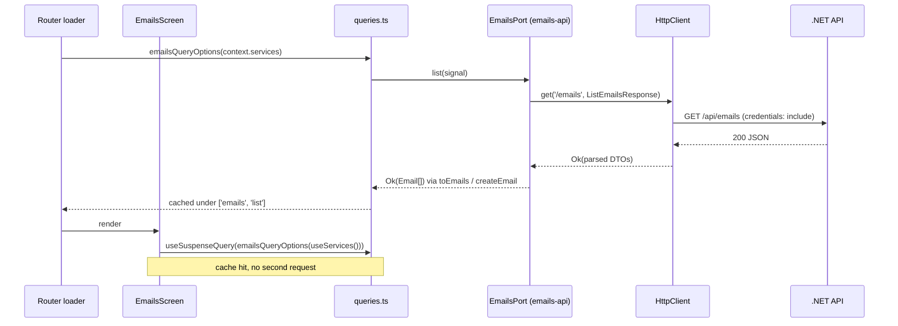

# Emails request flow

Failure path: the HTTP client or the mapper returns `Err(AppError)`; `queryFn` throws `QueryError(appError)`; the
router's `errorComponent` (`RootError`) shows `t(errorKey(appError))` and reports the error to `CrashReporter`. A 401
also calls `onUnauthorized`, which ends the session; the guard then redirects to `/sign-in`.

Layers involved: [features](features.md), [application](application.md), [adapters](adapters.md).
