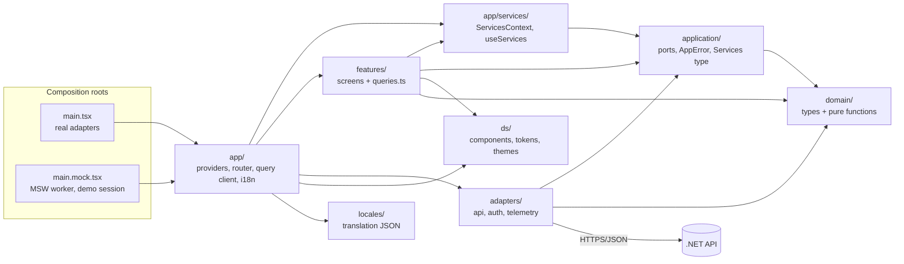

# Components (Web SPA)

Layers are folders under `src/`. Arrows are the only allowed imports; `eslint-plugin-boundaries` enforces them from
`eslint.boundaries.config.js` ([ADR 0010](../../adr/0010-hexagonal-layers-boundaries-and-services.md)).

| Component | Responsibility | Imports | Never |
|---|---|---|---|
| `domain` | Entities, value objects, `Result` | nothing | frameworks, I/O |
| `application` | One port per resource, `AppError`, `Services` | `domain` | frameworks, I/O |
| `adapters` | Implement ports; map HTTP/zod failures to `Err` | `application`, `domain` | throw for expected failures; be imported by features |
| `ds` | Components, tokens, light/dark via `[data-theme]` | nothing but React | know the domain, depend on i18n |
| `features` | Screens, `queries.ts` (keys, `queryOptions`, mutations), layout-only CSS Modules | `application`, `domain`, `ds`, `app/services` | import adapters, other features, other `app/` code |
| `app` | Providers, router (typed context), query client, theme, i18n, `app/services/` | all | hold business rules |
| `locales` | Translation JSON, `en.json` as source | nothing | be imported by `features`, `ds` or `adapters` |

Tests (`src/test/**`, `*.test.*`) may import everything, and test helpers only each other (production code cannot import `src/test/`); `main.tsx` and `main.mock.tsx` form the `root` file category: they may import any layer and nothing may import them.

Constraints per layer: [Constraints](../../engineering/constraints.md).

## Notes
* Each layer has its own page with its files and key types: [domain](domain.md), [application](application.md), [adapters](adapters.md), [ds](ds.md), [features](features.md), [app](app.md), [locales](locales.md). The request path for the sample feature is in [Emails request flow](emails-sequence.md). `adapters/live` does not exist; it is a [backlog](../../backlog/realtime-live-port.md) item.
* `app/services` is its own element in the lint config so the one `features -> app` edge stays a single matrix cell. Features may also import their own feature folder, never a sibling.
* `domain` and `application` also ban `zod`, `i18next`, `react-i18next` and `msw` (K1), not only React and TanStack.
* Rules are checked by `src/test/boundaries.test.ts` against the fixtures in `src/test/boundary-fixtures/` (alias, relative, `import type` and dynamic `import()`).

## Unverified
* Mock mode swaps the entry in `index.html` through a Vite plugin and builds into `dist-mock/` ([ADR 0017](../../adr/0017-test-harness.md)); the e2e smoke test runs against it.
* Per-layer constraints in [Constraints](../../engineering/constraints.md) mark K1, K6, K20 and K30 as enforced by the boundaries lint and its self-test.
